# AUDITORIA DE AUTENTICAÇÕES — ANTIGRAVITY
## Área Nobre e Fescopan | Etapa A.1
### Relatório de Diagnóstico de Infraestrutura, Desacoplamento e Segurança

**Data da Auditoria:** 10 de Novembro de 2026  
**Ambiente de Execução:** `area-nobre-dev` (`C:\Guilherme\Corretora Daiane\area-nobre-dev`)  
**Modo:** Estritamente leitura (nenhuma alteração, login, logout ou comando de escrita executado)

---

### 1. Resumo Executivo

O objetivo desta auditoria é assegurar que o desenvolvedor possa trabalhar simultaneamente em duas instâncias (janelas) do **Antigravity** — uma no projeto **Área Nobre** e outra no projeto **Fescopan** — garantindo:

1. **Preservação Integral do Antigravity/Gemini:** A conta Google/Gemini paga que alimenta o assistente de IA permanece 100% ativa, inalterada e compartilhada entre as janelas, sem qualquer dependência ou interferência das contas dos projetos.
2. **Isolamento de Infraestrutura:** As credenciais de Git/GitHub, Vercel e Supabase de cada projeto operam de forma estanque e sem risco de contaminação cruzada.
3. **Proteção da Fescopan:** A sessão ativa da Fescopan na Vercel e seus repositórios Git não sofrerão sobrescrita ou desautenticação acidental.

---

### 2. Mapa das Autenticações Atuais

| Serviço / Camada | Escopo no Sistema | Projeto Fescopan | Projeto Área Nobre | Estado Atual de Isolamento |
|---|---|---|---|---|
| **Antigravity / Gemini** | Global da Aplicação (`C:\Users\user\.gemini\antigravity`) | Conta Google ativa (Gemini Pago) | Mesma Conta Google ativa (Gemini Pago) | **COMPARTILHADO E SEGURO** (Independente das CLIs) |
| **Git & GitHub** | Local por repositório (`.git/config` em cada projeto) | `user.name = Fescopan` `user.email = fescopan@gmail.com` Repo: `github.com/Fescopan/...` | `user.name = Area Nobre` `user.email = areanobreapp@gmail.com` Repo: `github.com/areanobreapp/...` | **100% ISOLADO** (Sem `~/.gitconfig` global; GCM gerencia por URL/host) |
| **Supabase** | Local por projeto (variáveis de ambiente `.env`) | Ref: `yfmuuavpxfnblfbqiraa` (Staging via `.env.local` / Vite) | Ref DEV: `jdoezhmtwicxcthhedtb` Ref Prod: `udtqyoinwnalbvodejxj` (Prisma + Next.js via `.env`) | **100% ISOLADO** (Sem CLI vinculada globalmente; `~/.supabase` sem tokens) |
| **Vercel CLI** | Global do SO (`AppData\Roaming\com.vercel.cli\Data`) | Usuário: `fescopan-7549` Time: `guilherme-reis-projects1` Projeto: `prj_4DiVSLkd4ZKFI3rdAHyXxmNjAp0U` | Organização: `areanobreapp` Projeto: `area-nobre-homolog` (Sem sessão ativa na CLI local) | **COMPARTILHAMENTO GLOBAL DA SESSÃO** (Único ponto de atenção) |

---

### 3. O que é Compartilhado entre Janelas do Antigravity

- **A Instalação do Antigravity e a Conta Google/Gemini:**  
  O Antigravity é instalado no perfil do usuário do Windows. Todas as janelas do editor conectam-se ao mesmo processo de backend da ferramenta. A autenticação Google que fornece a cota paga de IA para o modelo Gemini 2.0 é **global no aplicativo**.
- **Diretório de Configuração da Vercel CLI:**  
  O executável `vercel` (versão `65.14.0`), por padrão, lê e grava credenciais em `C:\Users\user\AppData\Roaming\com.vercel.cli\Data\auth.json`. Atualmente, essa sessão está vinculada à conta **`fescopan-7549`**.
- **Gerenciador de Credenciais do Windows (GCM):**  
  O Windows Credential Manager armazena tokens para `github.com`. Como cada projeto utiliza sua própria URL com usuário embutido (`areanobreapp@github.com` vs `github.com/Fescopan`), o Windows armazena as chaves em entradas separadas sem conflito.

---

### 4. O que é Específico de Cada Projeto (Já Isolado)

1. **Identidades Git Locais:**  
   Não existe arquivo global `C:\Users\user\.gitconfig`. Todo commit ou log utiliza estritamente o `.git/config` da pasta do projeto. No Área Nobre os commits saem como `Area Nobre <areanobreapp@gmail.com>`, e no Fescopan saem como `Fescopan <fescopan@gmail.com>`.
2. **Bancos de Dados Supabase:**  
   Nenhum projeto depende de login da Supabase CLI (`supabase login`). Ambos operam via variáveis de ambiente exclusivas em seus respectivos arquivos `.env` / `.env.local`. O Área Nobre conecta via Prisma na porta 6543/5432 ao projeto `jdoezhmtwicxcthhedtb`, enquanto a Fescopan conecta no cliente Vite ao projeto `yfmuuavpxfnblfbqiraa`. Não há risco de contaminação mútua.
3. **Vínculos de Projeto Local (`.vercel`):**  
   O projeto Fescopan possui a pasta `.vercel/project.json` vinculando-o ao projeto `prj_4DiVSLkd4ZKFI3rdAHyXxmNjAp0U`. O projeto Área Nobre **não possui** pasta `.vercel`, não havendo nenhum acoplamento acidental com o projeto da Fescopan.

---

### 5. Riscos de Troca de Contas (O que NÃO Deve Ser Feito)

> [!CAUTION]
> **Ação Proibida:** Executar `npx vercel login` ou `npx vercel switch` diretamente na janela do Área Nobre sem isolamento de configuração.
>
> **Consequência:** A Vercel CLI sobrescreveria o arquivo `C:\Users\user\AppData\Roaming\com.vercel.cli\Data\auth.json`, desautenticando a conta `fescopan-7549`. Isso quebraria os comandos de build/deploy da Fescopan na outra janela.

---

### 6. Análise Técnica das Estratégias de Isolamento da Vercel

Auditou-se a versão instalada da Vercel CLI (`65.14.0 native`) para verificar os mecanismos de isolamento suportados:

```mermaid
flowchart TD
    subgraph "Sessão Global Padrão (FESCOPAN)"
        DEF["%APPDATA%\\com.vercel.cli\\Data"]
        DEF --> F_AUTH["auth.json (fescopan-7549)"]
        DEF --> F_PROJ["Fescopan Simulador"]
    end

    subgraph "Opção A: Diretório Separado"
        DIR_AN["C:\\Users\\user\\.vercel-areanobre"]
        DIR_AN --> A_AUTH["auth.json (areanobreapp)"]
        DIR_AN --> A_PROJ["area-nobre-homolog"]
    end

    subgraph "Opção B: Autenticação por Token"
        ENV_VAR["Variável de Ambiente VERCEL_TOKEN"]
        ENV_VAR -.->|Sobrescreve auth.json| CMD["Comando Vercel no Área Nobre"]
    end

    subgraph "Opção C: CI/CD via GitHub + Painel Web"
        GIT["git push origin feature/..."] --> V_WEB["Vercel GitHub App (Automático)"]
        V_WEB --> A_DEPLOY["Deploy area-nobre-homolog"]
    end
```

#### Comparativo Técnico:

| Critério | Opção A: Diretório Global Separado (`--global-config`) | Opção B: Token Específico (`VERCEL_TOKEN`) | Opção C: Git + Painel Web (Sem CLI no Área Nobre) |
|---|---|---|---|
| **Como funciona** | Usa `-Q <DIR>` ou `VERCEL_GLOBAL_CONFIG` apontando para `C:\Users\user\.vercel-areanobre`. | Define `VERCEL_TOKEN` temporário na sessão PowerShell ou script local. | A CLI local fica só para Fescopan. O Área Nobre faz deploy automático via `git push` e consulta no navegador. |
| **Segurança para Fescopan** | **Alta**: Sessão padrão da Fescopan permanece 100% intocada. | **Alta**: Tokens de processo têm prioridade sobre o arquivo global. | **Máxima**: Nenhuma credencial do Área Nobre toca o disco local. |
| **Facilidade de Manutenção** | Média: Exige passar `-Q` ou configurar script `.bat`/PowerShell. | Média: Exige gerar token de automação na Vercel. | **Muito Alta**: Fluxo padrão já utilizado por equipes modernas. |
| **Compatibilidade com Windows** | Suportado nativamente pela CLI 65.14.0 (`-Q, --global-config <DIR>`). | Suportado nativamente (`-t, --token <TOKEN>` e variável de ambiente). | Compatibilidade universal (não depende do SO). |
| **Risco de Erro Humano** | Baixo, desde que os comandos usem alias ou script dedicado. | Baixo. | **Zero**. |

---

### 7. Estratégia Recomendada de Isolamento

A estratégia mais robusta, segura e elegante para este cenário é a **Combinação das Opções C e B**:

1. **Para Operações do Dia a Dia (Deploy de Homologação / CI/CD): Opção C**  
   - O projeto Área Nobre já está conectado ao GitHub (`areanobreapp/area-nobre-app`).
   - Todo deploy de homologação ocorre de forma automática e segura ao autorizar o `git push origin feature/compartilhamento-melhorias`.
   - Isso elimina qualquer necessidade de login ou comandos de deploy da Vercel na máquina local, garantindo zero atrito com a Fescopan.
2. **Para Consultas Pontuais de Variáveis e Logs via Terminal: Opção B (Token) ou A (Diretório Isolado)**  
   - Caso seja necessário rodar comandos como `vercel env ls` ou `vercel logs` no Área Nobre, cria-se um script local seguro que injeta `VERCEL_TOKEN` ou aponta para `-Q C:\Users\user\.vercel-areanobre`, sem jamais tocar no `auth.json` da Fescopan.

---

### 8. Procedimento Futuro de Configuração (Guia de Execução Quando Autorizado)

> **Nota:** Conforme as regras da Etapa A.1, este procedimento **NÃO FOI EXECUTADO**. Fica registrado apenas para referência futura.

#### Se for adotada a Opção B (Token dedicado no Área Nobre):
1. Acessar `https://vercel.com/account/tokens` logado na conta `areanobreapp`.
2. Criar um token nomeado `antigravity-area-nobre-dev` com escopo restrito.
3. No terminal do Área Nobre, executar os comandos precedidos de `$env:VERCEL_TOKEN="..."`.

#### Se for adotada a Opção A (Diretório Vercel Isolado):
1. Criar o diretório: `mkdir C:\Users\user\.vercel-areanobre`
2. Autenticar exclusivamente nesse diretório:  
   `npx vercel --global-config C:\Users\user\.vercel-areanobre login`
3. Criar um atalho ou script `an-vercel.ps1` no projeto:  
   `npx vercel --global-config C:\Users\user\.vercel-areanobre $args`

---

### 9. Garantias de Preservação

1. **Conta Google / Gemini Pago:**  
   A inteligência artificial do Antigravity continuará ativa e idêntica em ambas as janelas. O Gemini é um serviço da IDE, enquanto Vercel, Git e Supabase são ferramentas externas de terminal. Nenhuma configuração de infraestrutura altera o login Google.
2. **Ambiente Fescopan:**  
   O arquivo de credenciais `AppData\Roaming\com.vercel.cli\Data\auth.json` e o repositório `fescopan-simulador-arranjos` permanecem intactos.

---

### 10. Pendências para Confirmação Manual

1. **Acesso do Usuário ao Painel Vercel `areanobreapp`:**  
   Confirmar se o usuário consegue acessar pelo navegador o painel `https://vercel.com/areanobreapp` para visualização das variáveis de homologação ou geração de token se desejado.
2. **Validação do Fluxo Automático de Homologação:**  
   Confirmar se o usuário deseja realizar o envio de código para homologação prioritariamente via **Git Push contínuo (Opção C)**, que dispensa qualquer manipulação de credenciais Vercel no terminal local.

---

### 11. Conclusão da Etapa A.1

- Auditoria concluída com sucesso e em modo estritamente de leitura.
- Nenhuma credencial foi exposta.
- O diagnóstico comprova que **Git e Supabase já estão 100% isolados**, e que a Vercel possui alternativas nativas e seguras para convivência sem afetar a Fescopan nem o Gemini pago.
- **Aguardando autorização do usuário para a próxima etapa.**

