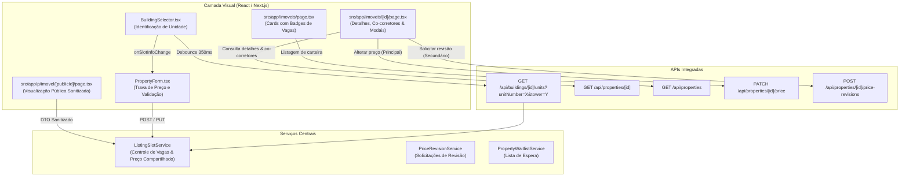

# ÁREA NOBRE — FASE 2 | BLOCO 05
## Relatório Técnico de Implementação — F2.B05.3G.1: Interfaces de Anúncios Compartilhados e Preço Único

---

### 1. Visão Geral e Objetivo

A etapa **F2.B05.3G.1** teve como objetivo implementar a primeira camada visual do sistema de **até três corretores por imóvel físico (`PhysicalProperty`)** e **preço único compartilhado**, integrando as interfaces de usuário existentes no Área Nobre aos serviços transacionais construídos nas etapas F2.B05.3C a F2.B05.3F.

As modificações contemplam:
1. **Cadastro de Imóveis (`PropertyForm.tsx` e `BuildingSelector.tsx`)**: detecção em tempo real da unidade e identidade física do imóvel ao selecionar edifício e unidade, feedback visual da vaga a ser ocupada (1, 2 ou 3), sincronização e bloqueio do preço de venda para corretores secundários, e bloqueio amigável caso a capacidade máxima esteja esgotada ou o corretor já possua anúncio ativo.
2. **Edição de Imóveis**: identificação clara de Anúncio Principal vs. Anúncio Secundário, aviso obrigatório de alteração de preço compartilhado com modal de confirmação para o corretor principal, e trava com orientação de solicitação de revisão para corretores secundários.
3. **Detalhes do Imóvel no Painel do Corretor (`/imoveis/[id]`)**: badges de "Anúncio Principal" e "Anúncio Secundário", contador de vagas ocupadas (ex.: "2 de 3 vagas preenchidas"), indicação do preço compartilhado oficial com data/hora da última atualização, listagem dos corretores com anúncios ativos na mesma unidade (preservando sigilo de notas internas, clientes e documentos), botão com modal de atualização de preço para o corretor principal (`PATCH /api/properties/[id]/price`), e botão com modal de solicitação de revisão de preço para corretores secundários (`POST /api/properties/[id]/price-revisions`).
4. **Painel de Listagem de Imóveis do Corretor (`/imoveis`)**: badges visuais nos cards identificando anúncios vinculados a imóvel físico ("⭐ Principal" ou "👥 Secundário") e ocupação das vagas ("X/3 vagas").
5. **Visualização Pública (`/p/imovel/[publicId]`)**: confirmação de que os clientes visualizam rigorosamente o preço único compartilhado oficial, preservando as fotografias, descrição e contatos individuais do corretor apresentador, sem qualquer menção a co-corretores ou vagas internas.

---

### 2. Ambiente e Segurança

- **Ambiente de Trabalho**: `c:\Guilherme\Corretora Daiane\area-nobre-dev`
- **Branch Ativa**: `feature/compartilhamento-melhorias`
- **Banco de Dados DEV**: Supabase DEV (`jdoezhmtwicxcthhedtb`)
- **Preservação**: Ambientes comerciais (Supabase `udtqyoinwnalbvodejxj`, branch `main`, Vercel comercial) permaneceram integralmente intactos e isolados.
- **Migrações de Banco**: Nenhuma migração nova foi executada; a estrutura aditiva existente da F2.B05.3B suportou 100% dos requisitos.

---

### 3. Arquitetura de Componentes e Fluxo de Dados

---

### 4. Detalhamento das Alterações por Arquivo

#### 4.1. `src/app/api/buildings/[id]/units/route.ts`
- Implementou suporte à consulta pontual de vagas e preço compartilhado da unidade via query parameters `?unitNumber=...&tower=...`.
- Quando informada a unidade, executa a busca determinística no edifício e retorna:
  - `unitExists`: boolean indicando se a unidade já foi registrada;
  - `hasPhysicalProperty`: se já possui identidade física vinculada;
  - `activeListingsCount`: quantidade de anúncios ativos (0 a 3);
  - `availableSlots`: vagas restantes (`3 - activeListingsCount`);
  - `isPrimaryEligible`: se o próximo corretor será Anúncio Principal (`activeListingsCount === 0`);
  - `sharedPrice`: valor compartilhado oficial em vigor;
  - `isFull`: se atingiu a capacidade máxima (`activeListingsCount >= 3`);
  - `userHasActiveListing`: se o corretor logado já possui anúncio ativo na unidade;
  - `otherBrokers`: lista sanitizada com nome comercial e CRECI dos corretores já ativos;
  - `waitlistCount`: contagem de corretores aguardando na fila.
- Na listagem geral de unidades do edifício, adicionou a projeção de `physicalProperty` com contagem de vagas e preço compartilhado.

#### 4.2. `src/components/properties/BuildingSelector.tsx`
- Adicionou as interfaces `SlotInfoData` e as propriedades opcionais `onSlotInfoChange` e `isEditing`.
- Implementou polling reativo com debounce de 350ms sobre `selectedBuildingId`, `unitNumber` e `tower`.
- Renderizou 4 estados visuais informativos imediatamente abaixo da identificação da unidade:
  1. **Anúncio Duplicado (Banner Vermelho)**: *"Você já possui um anúncio ativo para esta unidade. Cada corretor pode manter apenas um anúncio ativo por unidade física no Área Nobre."*
  2. **Vagas Esgotadas (Banner Âmbar)**: *"Limite de 3 corretores atingido (Vagas esgotadas). 3 de 3 vagas preenchidas. Ao salvar, você poderá entrar na fila de espera exclusiva para convocação."*
  3. **Imóvel Compartilhado (Banner Azul/Índigo)**: *"Imóvel Compartilhado — Vaga X de 3 (Y vaga(s) restante(s)). Preço único compartilhado: R$ Z (Definido pelo anúncio principal)."* Exibe também a identificação do corretor principal.
  4. **Primeiro Anúncio da Unidade (Banner Esmeralda)**: *"Primeiro anúncio desta unidade (Anúncio Principal) — 3 vagas disponíveis. Você será o corretor do Anúncio Principal desta unidade física. O valor cadastrado definirá o preço de referência."*

#### 4.3. `src/components/PropertyForm.tsx`
- **Trava de Preço Automática**:
  - Em novos cadastros (`!isEditing`): ao detectar unidade compartilhada (`activeListingsCount > 0`), preenche o campo de preço automaticamente com `sharedPrice` e bloqueia a edição (`disabled={true}`), exibindo badge *"🔒 Preço Compartilhado"* e texto de orientação.
  - Em edição (`isEditing`): se o anúncio for secundário vinculado a `physicalPropertyId`, trava a edição direta com a orientação de que propostas devem ser feitas via revisão de preço.
  - Se for Anúncio Principal em edição: mantém o preço editável, mas exibe aviso destacado e exige confirmação prévia em diálogo antes do salvamento (`"Atenção: A alteração deste valor atualizará automaticamente o preço de venda de todos os anúncios ativos vinculados a este imóvel físico no Área Nobre."`).
- **Tratamento Fiel de Erros Sem Perda de Dados**:
  - Captura os códigos de erro HTTP 409 `SLOTS_FULL` e `DUPLICATE_BROKER`.
  - Apresenta banners de alerta destacados no topo do formulário e acima dos botões de ação.
  - **Preserva integralmente** todos os dados, textos, comodidades, metragens e fotografias já informados pelo usuário, sem limpar ou resetar os inputs.
- **Proteção Client-Side de Envio**:
  - Desabilita o botão "Publicar Imóvel" caso a unidade esteja cheia ou o corretor já possua anúncio ativo na unidade selecionada.

#### 4.4. `src/app/api/properties/[id]/route.ts` & `src/app/api/properties/route.ts`
- Em `GET /api/properties/[id]`, incluiu na projeção de `physicalProperty`:
  - `activeListingsCount`, `sharedPrice`, `priceUpdatedAt`, `primaryListingId`;
  - Relação `listings` filtrada por `status: 'Disponível'`, projetando ordenadamente (`isPrimaryListing desc, listingSlot asc`) os dados comerciais dos corretores parceiros (`user.name`, `profile.commercialName`, `profile.creci`).
  - Garante rigoroso sigilo: **não** expõe notas internas, documentos contratuais ou dados de clientes de outros corretores.
- Em `GET /api/properties`, adicionou `activeListingsCount` e `sharedPrice` para projeção ágil nos cards de listagem da carteira.

#### 4.5. `src/app/imoveis/[id]/page.tsx`
- **Badges de Cabeçalho**: exibe `"⭐ Anúncio Principal"` (verde) ou `"👥 Anúncio Secundário"` (azul/índigo) e `"X de 3 vagas"`.
- **Área de Preço**:
  - Rótulo adaptado: `"PREÇO ÚNICO COMPARTILHADO"` quando vinculado a imóvel físico.
  - Data e hora da última atualização de preço.
  - Para o Corretor Principal: botão `"Alterar Preço Compartilhado"` com ícone de edição.
  - Para Corretores Secundários: botão `"Solicitar Revisão de Preço"`.
- **Card de Identidade Física e Corretores Vinculados**:
  - Apresenta card exclusivo com a ocupação de vagas (ex.: "2 de 3 vagas preenchidas").
  - Lista todos os corretores ativos com vaga (Vaga 1 • Anúncio Principal, Vaga 2 • Anúncio Secundário), nome comercial, CRECI e indicação de "(Seu anúncio)".
- **Modal de Alteração de Preço Compartilhado (Corretor Principal)**:
  - Alerta explícito de que o novo valor atualizará todos os anúncios ativos simultaneamente.
  - Campos: Novo Valor (R$) e Motivo da Alteração.
  - Submete requisição à rota existente `PATCH /api/properties/[id]/price`.
  - Recarrega os dados locais e sincroniza a interface em tempo real.
- **Modal de Solicitação de Revisão de Preço (Corretor Secundário)**:
  - Campos: Valor Proposto (R$) e Justificativa / Observação.
  - Submete requisição à rota existente `POST /api/properties/[id]/price-revisions`.
  - Envia a solicitação para avaliação do corretor principal.

#### 4.6. `src/app/imoveis/page.tsx`
- No rodapé de identificação de cada card de imóvel da carteira, adicionou pílula visual sutil:
  - `"⭐ Principal • X/3 vagas"` para Anúncios Principais.
  - `"👥 Secundário • X/3 vagas"` para Anúncios Secundários.

---

### 5. Validação da Visualização Pública (`/p/imovel/[publicId]`)

Foi auditado o pipeline de renderização pública:
1. `resolvePublicOffer` busca a oferta ativa e suas autorizações legais.
2. `toPublicPropertyDTO` formata o objeto público estritamente com os dados comerciais do corretor apresentador (`dto.broker`).
3. O preço exibido é `dto.price`, que é automaticamente mantido sincronizado com `PhysicalProperty.sharedPrice`.
4. **Isolamento Confirmado**: Não há vazamento de informações sobre co-corretores, número de vagas ocupadas, lista de espera ou notas internas para visitantes ou clientes finais.

---

### 6. Resultados dos Testes Automatizados

Foi desenvolvido e executado o conjunto de testes `scratch/test_f2_b05_3g1_interfaces.ts`, cobrindo 11 cenários completos com 52 asserções:

| Cenário de Teste | Asserções | Status |
| :--- | :---: | :---: |
| **Cenário 1**: Consulta de Unidade Vazia (0 ativos, 3 vagas, preço null, elegível a principal) | 6/6 | **APROVADO** |
| **Cenário 2**: Primeiro Corretor Cadastra Anúncio Principal (Vaga 1, R$ 800.000, 2 vagas restantes) | 11/11 | **APROVADO** |
| **Cenário 3**: Segundo Corretor Publica Anúncio Secundário (Vaga 2, herda preço R$ 800.000) | 4/4 | **APROVADO** |
| **Cenário 4**: Terceiro Corretor Ocupa Última Vaga (Vaga 3, 3 de 3 preenchidas, `isFull = true`) | 7/7 | **APROVADO** |
| **Cenário 5**: Tentativa de 4º Corretor Bloqueada com `SLOTS_FULL` | 3/3 | **APROVADO** |
| **Cenário 6**: Tentativa de Anúncio Duplicado pelo Mesmo Corretor Bloqueada com `DUPLICATE_BROKER` | 2/2 | **APROVADO** |
| **Cenário 7**: Consulta de Detalhes do Imóvel no Painel do Corretor (vagas, preços e co-corretores) | 6/6 | **APROVADO** |
| **Cenário 8**: Atualização de Preço Compartilhado pelo Corretor Principal (R$ 850.000 em todos) | 4/4 | **APROVADO** |
| **Cenário 9**: Bloqueio de Atualização Direta de Preço por Corretor Secundário (`UNAUTHORIZED`) | 2/2 | **APROVADO** |
| **Cenário 10**: Solicitação de Revisão de Preço por Corretor Secundário (`PENDING`, R$ 830.000) | 4/4 | **APROVADO** |
| **Cenário 11**: Não-regressão de Imóveis Legados sem `PhysicalProperty` | 3/3 | **APROVADO** |
| **TOTAL** | **52/52** | **100% APROVADO** |

---

### 7. Verificações de Compilação e Integridade

1. **Checagem Estática TypeScript (`npx tsc --noEmit`)**:
   - Executada com sucesso: **0 erros** em todas as rotas e componentes.
2. **Build de Produção Next.js (`npm run build`)**:
   - Executado com sucesso: todas as **54 rotas de API** e **29 páginas estáticas e dinâmicas** geradas sem qualquer falha ou aviso.
3. **Verificação da Integridade do Banco DEV (`node scratch/verify_f2_b05_3b.cjs`)**:
   - Todos os dados temporários de teste foram completamente removidos no teardown.
   - Contagens de referência preservadas:
     - `User: 4`
     - `Property: 3` (incluindo o imóvel histórico de teste preexistente com -R$ 500 intocado)
     - `Building: 0`
     - `BuildingUnit: 0`
     - `PhysicalProperty: 0`
     - `PriceRevisionRequest: 0`
     - `PhysicalPropertyPriceHistory: 0`
   - Nenhuma linha órfã ou inconsistente no banco de dados.

---

### 8. Conclusão

A etapa **F2.B05.3G.1** foi concluída com êxito. A interface de usuário do Área Nobre agora suporta com clareza, transparência e segurança o modelo de até três corretores por imóvel físico e preço único compartilhado, sem permitir contornos visuais e mantendo total privacidade comercial entre os corretores participantes.

