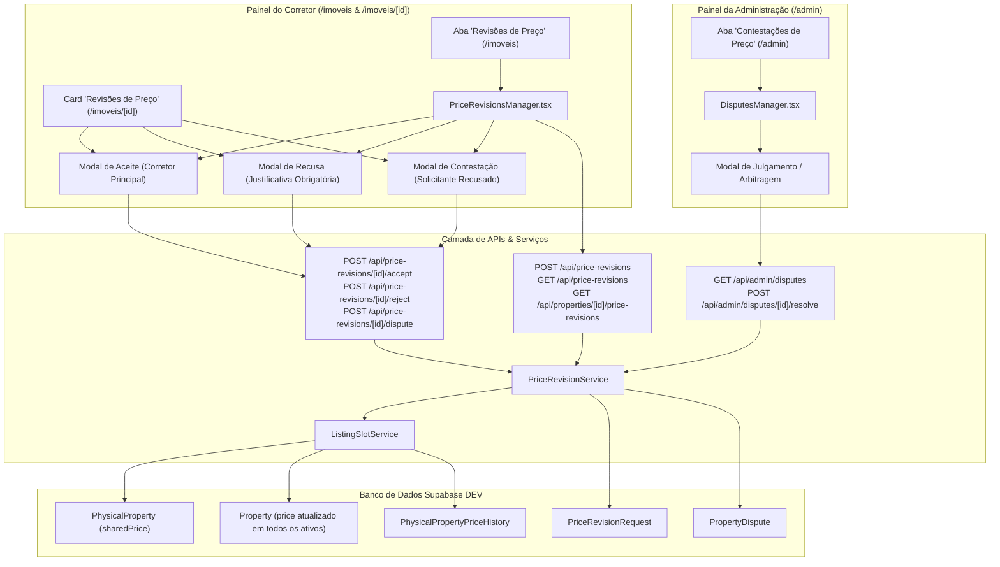

# ÁREA NOBRE — FASE 2 | BLOCO 05
## F2.B05.3G.2 — Interfaces de Revisão de Preço e Contestações Administrativas

---

### 1. Contexto e Objetivos da Etapa

A etapa **F2.B05.3G.2** consolida a experiência visual e interativa completa do sistema de revisão de preço compartilhado e contestações administrativas da plataforma **Área Nobre**, integrando os serviços transacionais e rotas de API construídos na etapa `F2.B05.3E` (`PriceRevisionService`, `ListingSlotService` e `/api/price-revisions`, `/api/admin/disputes`).

O objetivo foi proporcionar uma experiência transparente, fluida e juridicamente consistente tanto para os corretores quanto para o administrador da plataforma:

1. **Visão do Corretor Secundário:**
   - Acompanhamento das solicitações de revisão enviadas com preço atual, preço sugerido, justificativa e status (`PENDING`, `APPROVED`/`ACCEPTED`, `REJECTED`, `ESCALATED`/`DISPUTED`).
   - Em caso de recusa pelo corretor principal, visualização clara do motivo da recusa e possibilidade de acionar contestação administrativa sem duplicidades.
2. **Visão do Corretor Principal:**
   - Visualização das solicitações de revisão recebidas no detalhe do imóvel e no painel central de revisões.
   - Ações de aceite direto (com sincronização atômica imediata do preço em todos os anúncios ativos) e recusa com justificativa obrigatória.
   - Proteção de concorrência com rejeição automática em caso de preço defasado (`STALE_PRICE`).
3. **Visão Centralizada da Carteira de Imóveis (`/imoveis`):**
   - Nova aba de navegação *"Revisões de Preço"*, permitindo alternar facilmente entre solicitações recebidas como anúncio principal e solicitações enviadas como anúncio secundário.
4. **Painel Administrativo (`/admin`):**
   - Nova aba dedicada *"Contestações de Preço"*, com métricas de contestações pendentes e julgadas, filtros, busca em tempo real e modal de arbitragem arbitral (`APPROVE` deferir / `REJECT` indeferir) com parecer administrativo obrigatório, sem suspensões punitivas automáticas.

---

### 2. Ambiente de Desenvolvimento e Salvaguardas

| Parâmetro | Configuração |
| :--- | :--- |
| **Workspace Local** | `C:\Guilherme\Corretora Daiane\area-nobre-dev` |
| **Branch Ativa** | `feature/compartilhamento-melhorias` |
| **Banco de Dados** | Supabase DEV (`jdoezhmtwicxcthhedtb`) |
| **Ambientes Comerciais** | **Totalmente preservados** (Supabase prod `udtqyoinwnalbvodejxj`, branch `main`, Vercel prod) |
| **Operações Proibidas** | Nenhum `commit`, `push` ou `deploy` executado sem autorização expressa |

---

### 3. Arquitetura dos Componentes Criados e Integrados

---

### 4. Detalhamento dos Componentes e Interfaces

#### 4.1. Painel Administrativo de Contestações — [`DisputesManager.tsx`](file:///c:/Guilherme/Corretora Daiane/area-nobre-dev/src/components/admin/DisputesManager.tsx)
- **Localização:** Integrado como a 5ª aba no painel `/admin` (`src/app/admin/page.tsx`).
- **Cards de Métricas:**
  - Contestações Pendentes de Arbitragem (destaque em âmbar com contador dinâmico).
  - Contestações Julgadas (verde com histórico).
  - Total de Casos Registrados.
- **Filtros e Busca:**
  - Abas: *Todas*, *Aguardando Decisão*, *Concluídas*.
  - Campo de busca instantânea filtrando por edifício, número da unidade, nome do corretor reclamante ou número de CRECI.
- **Detalhamento do Litígio:**
  - Edifício, endereço e unidade vinculada.
  - Preço Público Atual vs Preço Solicitado pelo Reclamante (com cálculo de variação percentual).
  - Dados completos do corretor solicitante (Nome, Nome Comercial, CRECI com link de verificação, e-mail e telefone formatado com botão direto para WhatsApp).
  - Justificativa original do corretor solicitante acompanhada do link da documentação comprobatória, quando anexada.
  - Motivo formal da recusa manifestado pelo Corretor Principal.
- **Modal de Arbitragem Administrativa:**
  - Opções exclusivas:
    - **Deferir (`APPROVE`):** Atualiza imediatamente o preço compartilhado de venda para o valor homologado (permitindo ao administrador ajustar o valor se necessário) e sincroniza todos os anúncios ativos.
    - **Indeferir (`REJECT`):** Mantém o preço compartilhado atual sem alterações.
  - **Parecer Administrativo Obrigatório (`adminNotes`):** Não permite submissão sem fundamentação detalhada do parecer da moderação.
  - **Política Não Punitiva:** Não suspende anúncios, não revoga mandatos nem bloqueia o acesso dos corretores envolvidos.

#### 4.2. Gestor de Revisões do Corretor — [`PriceRevisionsManager.tsx`](file:///c:/Guilherme/Corretora Daiane/area-nobre-dev/src/components/properties/PriceRevisionsManager.tsx)
- **Localização:** Integrado na página `/imoveis` como 3ª pílula seletora (`Meus Imóveis`, `Compartilhados Comigo`, `Revisões de Preço`).
- **Abas de Escopo:**
  - **Recebidas (Como Anúncio Principal):** Destaca solicitações pendentes de resposta, com botão de aceitar e recusar diretamente da lista.
  - **Minhas Solicitações Enviadas:** Exibe o histórico de pedidos efetuados pelo corretor secundário com badges de status (`Pendente`, `Aprovada`, `Recusada`, `Em Contestação Administrativa`).
- **Modais de Ação Rápida:**
  - *Modal de Aceite:* Informa de forma transparente que todos os corretores ativos terão o preço ajustado para o novo valor aceito.
  - *Modal de Recusa:* Exige justificativa formal mínima, gravada no histórico para visualização do solicitante e posterior auditoria.
  - *Modal de Abertura de Contestação:* Disponível imediatamente quando a solicitação se encontra `REJECTED`, permitindo anexar justificativa suplementar e link para comprovante de autorização com novo preço.

#### 4.3. Detalhe do Imóvel Compartilhado — [`src/app/imoveis/[id]/page.tsx`](file:///c:/Guilherme/Corretora Daiane/area-nobre-dev/src/app/imoveis/[id]/page.tsx)
- **Card Contextual de Revisões:**
  - Posicionado estrategicamente abaixo do card de co-corretores.
  - Se o usuário logado for o **Corretor Principal**: lista as revisões pendentes de seus co-corretores para aquele imóvel, com botões de ação imediata (*Aceitar Novo Preço* e *Recusar*).
  - Se for o **Corretor Secundário**: exibe o status de suas solicitações para aquele imóvel e, se houver recusa, o botão de acionamento da moderação administrativa.
  - Trata casos de desatualização concorrente (`STALE_PRICE`) alertando que o preço base sofreu alterações intermediárias.

---

### 5. Validação por Testes Automatizados

Foi desenvolvida uma suíte de testes ponta a ponta (`scratch/test_f2_b05_3g2_revisions.ts`) cobrindo 10 cenários de ciclo de vida completo com **56 asserções**:

| Cenário | Descrição do Teste | Asserções | Status |
| :---: | :--- | :---: | :---: |
| **0** | Alocação de vagas (Principal R$ 800k e Secundário) e sincronização inicial | 5 | ✅ Aprovado |
| **1** | Abertura de solicitação de revisão pelo Secundário (R$ 750k) | 5 | ✅ Aprovado |
| **2** | Bloqueio de solicitação duplicada enquanto houver pendência | 2 | ✅ Aprovado |
| **3** | Validação de rejeição de preço idêntico ao já praticado | 1 | ✅ Aprovado |
| **4** | Recusa da revisão pelo Principal com obrigatoriedade de justificativa | 8 | ✅ Aprovado |
| **5** | Abertura de contestação administrativa (`PropertyDispute`) pelo Secundário | 7 | ✅ Aprovado |
| **6** | Arbitragem administrativa com Indeferimento (`REJECT`) mantendo R$ 800k | 6 | ✅ Aprovado |
| **7** | Arbitragem administrativa com Deferimento (`APPROVE`) atualizando atômico para R$ 730k | 8 | ✅ Aprovado |
| **8** | Aceite direto de nova solicitação pelo Corretor Principal (sincronizando R$ 710k) | 8 | ✅ Aprovado |
| **9** | Tratamento de conflito de concorrência com preço defasado (`STALE_PRICE`) | 3 | ✅ Aprovado |
| **10** | Auditoria e integridade da trilha de auditoria em `PhysicalPropertyPriceHistory` | 3 | ✅ Aprovado |
| **Total** | **Todas as verificações de regras, segurança e integridade** | **56** | **100% Aprovado** |

---

### 6. Integridade de Compilação e Banco de Dados DEV

1. **Compilação e Verificação Estática de Tipos:**
   - `npx tsc --noEmit`: Executado com código de saída 0 (zero erros de tipagem em todo o repositório).
   - `npm run build`: Build de produção do Next.js gerado com êxito (54 rotas de API e 29 páginas estáticas/dinâmicas otimizadas).
2. **Higienização do Banco de Dados DEV:**
   - Script de validação `verify_f2_b05_3b.cjs` executado e aprovado com sucesso.
   - Contagem de imóveis mantida estritamente nos 3 registros legítimos pré-existentes (`Apartamento Demonstração`, `Imóvel Negativo Teste`, `terreno 1 linha`).
   - Zero registros órfãos ou de teste deixados em `PriceRevisionRequest`, `PropertyDispute`, `PhysicalPropertyPriceHistory` ou `PhysicalProperty`.

---

### 7. Resumo das Regras de Negócio Homologadas

> [!IMPORTANT]
> **Consistência de Preço Único:** Qualquer deferimento administrativo ou aceite pelo corretor principal dispara a atualização transacional em `PhysicalProperty` e em **todos os anúncios ativos** no mesmo bloco transacional, gerando exatamente um registro de histórico.

> [!NOTE]
> **Moderação Construtiva e Não Punitiva:** Divergências de preço submetidas à administração não geram cancelamento de anúncios nem inativação preventiva de corretores. Ambos mantêm seus anúncios ativos no preço homologado.

