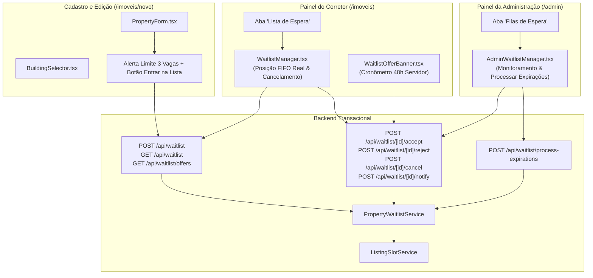

# ÁREA NOBRE — FASE 2 | BLOCO 05
## F2.B05.3G.3 — Interfaces da Lista de Espera e Convocação

---

### 1. Contexto e Objetivos da Etapa

A etapa **F2.B05.3G.3** conclui o ciclo visual e interativo da gestão de vagas por imóvel físico, implementando a experiência completa da **Lista de Espera** para corretores que desejam anunciar unidades com capacidade esgotada (3 vagas ativas preenchidas).

A implementação integra o backend construído na etapa `F2.B05.3F` (`PropertyWaitlistService` e rotas `/api/waitlist/*`), garantindo que:
1. **Entrada na Fila:** O corretor que tentar cadastrar uma unidade com 3 vagas ocupadas seja avisado de forma clara e amigável, com opção de entrar na lista de espera preservando integralmente os dados do seu anúncio como rascunho (`Inativo`).
2. **Acompanhamento no Painel:** O corretor possa consultar suas inscrições, sua posição cronológica real (FIFO) no servidor e o status em linguagem natural, sem termos técnicos internos.
3. **Oferta e Convocação Exclusiva:** Quando convocado, o corretor recebe aviso destacado no topo do painel com cronômetro regressivo preciso de 48 horas (baseado estritamente no horário do servidor), podendo aceitar ou recusar voluntariamente.
4. **Painel Administrativo:** A administração possa monitorar a fila de espera de todos os imóveis físicos da plataforma, disparar convocações formalmente para vagas reservadas e processar expirações sem possibilidade de alterar manualmente a ordem FIFO ou furar a regra de 3 vagas.

---

### 2. Ambiente de Desenvolvimento e Salvaguardas

| Parâmetro | Configuração |
| :--- | :--- |
| **Workspace Local** | `C:\Guilherme\Corretora Daiane\area-nobre-dev` |
| **Branch Ativa** | `feature/compartilhamento-melhorias` |
| **Banco de Dados** | Supabase DEV (`jdoezhmtwicxcthhedtb`) |
| **Ambientes Comerciais** | **Totalmente preservados** (Supabase prod `udtqyoinwnalbvodejxj`, branch `main`, Vercel prod) |
| **Operações Proibidas** | Nenhum `commit`, `push` ou `deploy` executado sem autorização expressa |

---

### 3. Auditoria do Mecanismo de Notificação e Prazos

Conforme diretriz da etapa:
> *"Não presumir que um endpoint equivale a uma notificação efetivamente entregue. Não iniciar automaticamente as 48 horas apenas porque o corretor abriu o aplicativo ou porque uma vaga foi liberada. Verificar se o sistema possui mecanismo funcional de notificação. Se não houver, implementar somente a apresentação de ofertas já disponibilizadas e documentar a pendência."*

#### 3.1. Diagnóstico da Infraestrutura Atual
1. **Canais de Envio Externos:** O projeto atualmente não possui bibliotecas ou provedores externos de mensageria configurados (como Twilio/WhatsApp API, Resend/SendGrid para e-mails transacionais ou OneSignal para WebPush).
2. **Fluxo de Estados Transacionais:**
   - Quando um anúncio ativo é inativado ou excluído, o serviço `processSlotAvailability` promove o próximo candidato em ordem FIFO para o status intermediário `PENDING_NOTIFICATION`.
   - **Neste momento, o prazo de 48 horas NÃO começa:** os campos `notifiedAt` e `expiresAt` permanecem nulos (`null`).
   - Apenas quando a convocação é formalmente disponibilizada (via endpoint `/api/waitlist/[id]/notify` acionado pela administração ou job dedicado), o status evolui para `OFFERED`, gravando:
     - `notifiedAt: new Date()`
     - `expiresAt: new Date(now + 48h)`
3. **Pendência Operacional Documentada:**
   - Recomenda-se para uma fase futura a integração de um disparador assíncrono (ex: webhook para WhatsApp Business API ou e-mail transacional via Resend) no momento da execução do `dispatchOfferNotification`. Enquanto isso, a interface visual no painel do corretor consulta as ofertas `OFFERED` de forma resiliente e transparente.

---

### 4. Arquitetura dos Componentes Criados e Integrados

---

### 5. Detalhamento das Interfaces e Experiência do Usuário

#### 5.1. Entrada na Fila de Espera — [`PropertyForm.tsx`](file:///c:/Guilherme/Corretora Daiane/area-nobre-dev/src/components/PropertyForm.tsx) e [`BuildingSelector.tsx`](file:///c:/Guilherme/Corretora Daiane/area-nobre-dev/src/components/properties/BuildingSelector.tsx)
- **Mensagem Amigável:**
  > *"Este imóvel já possui três corretores anunciantes. Você pode entrar na lista de espera e será avisado quando surgir uma oportunidade."*
- **Preservação Integral do Anúncio:**
  - Ao clicar no botão **"Entrar na lista de espera"**, o formulário salva automaticamente o anúncio como `Inativo` (preservando título, descrições, áreas, características, fotos e localização).
  - Em seguida, vincula o ID do anúncio rascunho (`draftPropertyId`) à inscrição na lista de espera (`POST /api/waitlist`).
  - Quando a vaga for aceita futuramente, o anúncio é automaticamente promovido para `Disponível` sem exigir recadastro.
- **Prevenção de Duplicidades:**
  - Se o corretor já estiver na fila para a unidade física selecionada, o formulário exibe uma badge verde informativa: *"Você já está inscrito na lista de espera deste imóvel (Posição: Xº na fila)"*, desabilitando inscrições concorrentes.

#### 5.2. Acompanhamento no Painel do Corretor — [`WaitlistManager.tsx`](file:///c:/Guilherme/Corretora Daiane/area-nobre-dev/src/components/properties/WaitlistManager.tsx)
- Integrado na página `/imoveis` sob a 4ª pílula seletora (*"Lista de Espera"*).
- **Cards Métricos:** *Em Espera Ativa*, *Ofertas Disponíveis*, *Vagas Conquistadas*.
- **Informações por Inscrição:**
  - Imóvel físico (Edifício, endereço e número da unidade com torre).
  - Preço público compartilhado homologado.
  - Posição cronológica real na fila (`1º lugar na fila FIFO`, `2º lugar na fila FIFO`).
  - Anúncio rascunho preservado com link de acesso rápido.
  - Data e hora de inscrição formatadas em pt-BR.
- **Linguagem Natural Sem Jargões Técnicos:**
  - `WAITING` ➔ *"Aguardando liberação de vaga"*
  - `PENDING_NOTIFICATION` ➔ *"Vaga reservada — Aguardando envio de convocação"*
  - `OFFERED` ➔ *"Convocado! Vaga disponível (Prazo de 48h)"*
  - `CLAIMED` ➔ *"Vaga assumida (Anúncio Ativo)"*
  - `REJECTED` ➔ *"Oferta recusada pelo corretor"*
  - `EXPIRED` ➔ *"Prazo de 48h expirado"*
  - `CANCELLED` ➔ *"Inscrição cancelada"*
- **Cancelamento Voluntário:**
  - Botão *"Cancelar inscrição"* para inscrições ativas (`WAITING`, `PENDING_NOTIFICATION`, `OFFERED`) com modal de confirmação.
  - Libera a vaga e convoca o próximo da fila se o usuário já possuía vaga reservada.

#### 5.3. Convocação em Destaque e Cronômetro de 48 Horas — [`WaitlistOfferBanner.tsx`](file:///c:/Guilherme/Corretora Daiane/area-nobre-dev/src/components/properties/WaitlistOfferBanner.tsx)
- Exibido de forma prioritária e destacada no topo da página `/imoveis`.
- **Cronômetro Regressivo Baseado no Servidor:**
  - O prazo de 48 horas é calculado a partir de `offer.expiresAt`, registrado no banco de dados.
  - O relógio atualiza a cada 1 segundo: `⏳ 47h 58m 20s restantes`.
  - Se o prazo for atingido, a interface sinaliza imediatamente `⚠️ Prazo de 48h expirado` e bloqueia a aceitação fora do prazo.
- **Botões de Ação Imediata:**
  - **"Aceitar Vaga e Ativar Anúncio"**: aciona `POST /api/waitlist/[id]/accept`, promove o anúncio de rascunho para `Disponível`, ocupa formalmente a vaga no imóvel físico e alinha o preço ao compartilhado.
  - **"Recusar vaga"**: aciona `POST /api/waitlist/[id]/reject` com confirmação e convoca imediatamente o próximo da fila FIFO.

#### 5.4. Painel de Monitoramento Administrativo — [`AdminWaitlistManager.tsx`](file:///c:/Guilherme/Corretora Daiane/area-nobre-dev/src/components/admin/AdminWaitlistManager.tsx)
- Integrado na página `/admin` sob a nova aba *"Filas de Espera"*.
- **Métricas Globais:** Total em Fila, Vagas Reservadas, Ofertas em Aberto e Vagas Conquistadas.
- **Filtros e Busca:** Busca instantânea por edifício, unidade, nome do corretor ou CRECI.
- **Controle Rigoroso de Regras:**
  - O administrador **não pode alterar manualmente a ordem FIFO** (garantia de conformidade comercial).
  - O administrador **não pode furar o limite de 3 vagas** (bloqueio transacional do servidor).
- **Ações Administrativas Autorizadas:**
  - **"Disponibilizar Convocação (Iniciar 48h)"**: disponível para inscrições em `PENDING_NOTIFICATION`, formalizando a oferta e iniciando a contagem de 48h.
  - **"Processar Expirações"**: varre ofertas vencidas e convoca automaticamente os próximos corretores elegíveis.

---

### 6. Validação por Testes Automatizados (100% de Aprovação)

Foi desenvolvida e executada a suíte de testes ponta a ponta [`scratch/test_f2_b05_3g3_waitlist.ts`](file:///c:/Guilherme/Corretora Daiane/area-nobre-dev/scratch/test_f2_b05_3g3_waitlist.ts), cobrindo **15 cenários** e **51 asserções** rigorosas:

| Cenário | Descrição do Teste | Asserções | Status |
| :---: | :--- | :---: | :---: |
| **1** | Ocupação das 3 vagas permitidas no imóvel físico (Broker 1, 2 e 3) | 5 | ✅ Aprovado |
| **2** | Bloqueio imediato do 4º corretor ao tentar ativar diretamente (`SLOTS_FULL`) | 3 | ✅ Aprovado |
| **3** | Inscrição do 4º corretor na lista de espera vinculando anúncio em rascunho | 4 | ✅ Aprovado |
| **4** | Bloqueio de inscrição duplicada ativa para o mesmo corretor (`DUPLICATE_WAITLIST`) | 2 | ✅ Aprovado |
| **5** | Inscrição do 5º corretor garantindo 2ª posição na fila FIFO | 2 | ✅ Aprovado |
| **6** | Consulta da fila real refletindo ordenação FIFO do servidor | 3 | ✅ Aprovado |
| **7** | Bloqueio de cancelamento por terceiro e cancelamento válido pelo titular | 4 | ✅ Aprovado |
| **8** | Liberação de vaga por inativação e promoção para `PENDING_NOTIFICATION` | 3 | ✅ Aprovado |
| **9** | Garantia de que o prazo de 48h NÃO iniciou (`notifiedAt` e `expiresAt` nulos) | 2 | ✅ Aprovado |
| **10** | Convocação formal via `/notify`: status `OFFERED` e prazo exato de 48 horas | 5 | ✅ Aprovado |
| **11** | Proteção de titularidade da oferta contra aceite por terceiros (`UNAUTHORIZED`) | 2 | ✅ Aprovado |
| **12** | Recusa voluntária pelo corretor e promoção automática do próximo da fila | 4 | ✅ Aprovado |
| **13** | Bloqueio de aceite após expiração (`OFFER_EXPIRED`) e varredura de expirações | 3 | ✅ Aprovado |
| **14** | Aceitação legítima dentro do prazo: vaga alocada, status `Disponível` e preço adotado | 5 | ✅ Aprovado |
| **15** | Preservação integral dos dados do anúncio (descrição, áreas) e teto de 3 vagas | 4 | ✅ Aprovado |
| **Total** | **Todas as regras comerciais, operacionais e de integridade** | **51** | **100% Aprovado** |

---

### 7. Integridade do Sistema e Banco de Dados DEV

1. **Compilação e Verificação de Tipos:**
   - `npx tsc --noEmit`: Executado com sucesso, **0 erros de tipagem**.
   - `npm run build`: Build de produção do Next.js gerado com êxito (todas as 54 rotas de API e 29 páginas otimizadas).
2. **Higienização do Banco de Dados DEV:**
   - Teardown completo executado ao final dos testes.
   - Script `verify_f2_b05_3b.cjs` executado: todas as contagens retornaram perfeitamente à base original (`User: 4`, `Property: 3`, `PhysicalProperty: 0`, `PropertyWaitlist: 0`).
   - Zero registros órfãos ou de teste deixados.
3. **Salvaguarda dos Ambientes Comerciais:**
   - Supabase comercial (`udtqyoinwnalbvodejxj`), branch `main` e produção Vercel intactos e intocados.
   - Nenhum commit, push ou deploy foi realizado.

