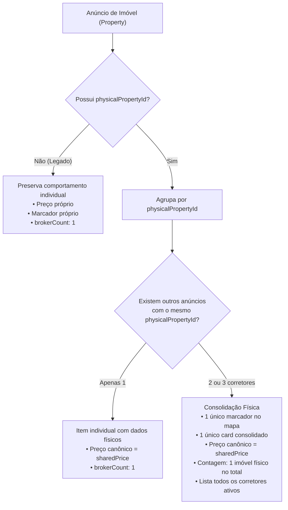

# ÁREA NOBRE — FASE 2 | BLOCO 05
## Relatório Técnico — F2.B05.3G.4: Agrupamento de Imóveis Compartilhados no Mapa e nas Buscas

**Data de Conclusão:** 10 de Novembro de 2026  
**Ambiente Autorizado:** DEV (`c:\Guilherme\Corretora Daiane\area-nobre-dev`)  
**Branch:** `feature/compartilhamento-melhorias`  
**Supabase DEV:** `jdoezhmtwicxcthhedtb` (Ambientes comerciais preservados integralmente)  

---

### 1. Resumo Executivo

A etapa **F2.B05.3G.4** implementou a unificação da identidade física dos imóveis (`PhysicalProperty`) nas buscas, na listagem de resultados consolidados e nos mapas interativos do sistema Área Nobre (`HomeMap` e `SearchMatchesMap`). 

Anteriormente, quando múltiplos corretores anunciavam a mesma unidade física (até o limite de 3 vagas ativas), cada anúncio gerava um marcador individual sobreposto e um card separado, multiplicando as contagens e causando poluição visual. Com a presente implementação:
- Anúncios vinculados ao mesmo `PhysicalProperty` são **agrupados em um único marcador geográfico e um único card consolidado**.
- O preço de referência canônico adotado é rigorosamente o **`PhysicalProperty.sharedPrice`**, eliminando distorções de preço ou indicações enganosas ("a partir de").
- A contagem nos resumos e KPIs conta cada imóvel físico **exatamente uma vez**.
- A autonomia comercial dos corretores é plenamente preservada: o cliente/comprador visualiza a lista de todos os corretores anunciantes ativos na unidade e pode **escolher livremente qual anúncio abrir**, sem direcionamento forçado ao corretor principal.
- Unidades diferentes no mesmo edifício (ex: Apt 101 e Apt 202) e imóveis vizinhos que compartilham coordenadas **permanecem rigorosamente distintos**.
- Imóveis legados (sem `physicalPropertyId`) mantêm seu comportamento individual preexistente.

---

### 2. Arquivos Modificados e Criados

| Arquivo | Tipo | Descrição da Modificação |
| :--- | :--- | :--- |
| [`src/lib/geo/property-grouping.ts`](file:///c:/Guilherme/Corretora%20Daiane/area-nobre-dev/src/lib/geo/property-grouping.ts) | Criado | Módulo centralizado com funções puras `consolidateProperties` e `consolidateMatches` para agrupamento determinístico por `physicalPropertyId`. |
| [`src/components/HomeMap.tsx`](file:///c:/Guilherme/Corretora%20Daiane/area-nobre-dev/src/components/HomeMap.tsx) | Modificado | Consolidação no mapa principal: 1 pin teardrop por imóvel físico exibindo `sharedPrice`, popup com badge e links de todos os co-corretores, drawer e cards com badge de corretores anunciantes e seletor. |
| [`src/app/page.tsx`](file:///c:/Guilherme/Corretora%20Daiane/area-nobre-dev/src/app/page.tsx) | Modificado | Inclusão de `physicalProperty` com co-anúncios ativos na query inicial e cálculo do KPI `propertiesCount` contando imóveis físicos únicos. |
| [`src/app/api/properties/route.ts`](file:///c:/Guilherme/Corretora%20Daiane/area-nobre-dev/src/app/api/properties/route.ts) | Modificado | Disponibilização de `physicalProperty` e co-anúncios públicos sanitizados para não-proprietários, preservando notas internas e dados sensíveis. |
| [`src/app/buscas/[id]/page.tsx`](file:///c:/Guilherme/Corretora%20Daiane/area-nobre-dev/src/app/buscas/[id]/page.tsx) | Modificado | Consolidação de matches em buscas salvas: 1 card por imóvel físico, badge de co-corretores e botões para escolher o anúncio de cada corretor. |
| [`src/components/SearchMatchesMap.tsx`](file:///c:/Guilherme/Corretora%20Daiane/area-nobre-dev/src/components/SearchMatchesMap.tsx) | Modificado | Mapa de oportunidades de busca: 1 pin por imóvel físico com score e `sharedPrice`, cards com identificador de compartilhamento e seletor de corretores. |
| [`src/app/api/searches/[id]/route.ts`](file:///c:/Guilherme/Corretora%20Daiane/area-nobre-dev/src/app/api/searches/[id]/route.ts) | Modificado | Retorno de `physicalProperty` nos matches de imóveis para suportar a agregação em tela. |
| [`src/lib/matching/normalizer.ts`](file:///c:/Guilherme/Corretora%20Daiane/area-nobre-dev/src/lib/matching/normalizer.ts) | Modificado | `normalizeProperty` agora adota `PhysicalProperty.sharedPrice` como preço canônico oficial para cálculo de compatibilidade. |
| [`src/lib/matching/service.ts`](file:///c:/Guilherme/Corretora%20Daiane/area-nobre-dev/src/lib/matching/service.ts) | Modificado | Queries de imóveis para matching passam a incluir `physicalProperty { sharedPrice }`. |
| [`scratch/test_f2_b05_3g4_grouping.ts`](file:///c:/Guilherme/Corretora%20Daiane/area-nobre-dev/scratch/test_f2_b05_3g4_grouping.ts) | Criado | Suíte de testes automatizada validando integralmente os 18 pontos obrigatórios. |

---

### 3. Regras de Agrupamento por Identidade Física

O agrupamento obedece a regras de integridade física determinísticas:

#### 3.1. Diferenciação de Casos Geográficos e Prediais
- **Unidades no mesmo edifício:** O agrupamento baseia-se **exclusivamente no `physicalPropertyId`**, e nunca apenas no `buildingId` ou nas coordenadas. A unidade 101 e a unidade 202 do Residencial Florença possuem `BuildingUnit` e `PhysicalProperty` distintos, permanecendo como itens independentes.
- **Imóveis vizinhos com coordenadas coincidentes:** Terrenos ou casas que eventualmente compartilhem o mesmo centróide de quadra continuam separados, pois possuem `PhysicalProperty` distintos.
- **Preservação de Legados:** Imóveis legados com `physicalPropertyId: null` não sofrem agrupamento arbitrário.

---

### 4. Apresentação no Mapa e Preço Compartilhado Canônico

1. **Marcador Geográfico (Leaflet):**
   - Imóveis compartilhados geram um único pin teardrop vetorial.
   - A etiqueta sobre o marcador apresenta o valor oficial canônico (`sharedPrice`).
   - O popup exibe o badge informativo: `Imóvel compartilhado • X corretores anunciantes`.
   - O popup lista individualmente cada corretor ativo com link direto para o respectivo anúncio (`/imoveis/${id}`).

2. **Preço Canônico:**
   - Em conformidade com a aprovação comercial da F2.B05.3B, **não se utiliza o menor preço nem o texto "A partir de"** para imóveis prontos compartilhados.
   - O valor de referência é rigorosamente `PhysicalProperty.sharedPrice`.
   - Filtros de preço mínimo e máximo atuam diretamente sobre o preço compartilhado oficial.
   - A ordenação de resultados utiliza o `sharedPrice`.

3. **Seletor de Corretores sem Favorecimento:**
   - No card consolidado e na gaveta lateral de pré-visualização, é exibido o bloco:  
     `Anúncios disponíveis nesta unidade: [ Corretor Alpha (Principal) ] [ Corretor Beta ] [ Corretor Gamma ]`
   - O usuário interessado pode clicar diretamente no corretor de sua preferência.
   - O sistema nunca redireciona compulsoriamente os clientes para o corretor principal.

---

### 5. Auditoria de Matching, Alertas, Buscas Salvas e Favoritos

1. **Cálculo de Compatibilidade:**
   - `normalizeProperty` foi atualizado para utilizar `PhysicalProperty.sharedPrice` (quando presente). Assim, se um anúncio secundário estiver com valor desatualizado em sua linha `Property`, o motor calcula a compatibilidade com base no preço real compartilhado do imóvel físico.
2. **Quantidade de Imóveis Encontrados:**
   - As contagens de oportunidades em `/buscas/[id]` utilizam `consolidatedMatches.length`, apresentando o número real de imóveis físicos que combinam com o perfil do cliente, evitando números inflados por co-anúncios.
3. **Alertas e Notificações:**
   - O cliente recebe a oportunidade consolidada no painel de buscas sem notificações redundantes do mesmo imóvel.
4. **Favoritos e Compartilhamento:**
   - Os links individuais e IDs originais permanecem totalmente funcionais. Cada anúncio continua apto a ser compartilhado por seu respectivo corretor via link público (`/p/imovel/[publicId]`).
5. **Recomendação de Arquitetura Futura:**
   - Atualmente, a tabela `Match` armazena o par `(searchId, propertyId)`. Caso a administração decida futuramente unificar a tabela de matches ao nível de `(searchId, physicalPropertyId)`, uma migração específica de banco poderá ser desenhada. Por ora, a consolidação em memória na camada de serviço e API cumpre todos os requisitos comerciais de forma segura e sem necessidade de migrações estruturais.

---

### 6. Privacidade e Segurança

- **Campos Confidenciais:** Notas internas (`internalNotes`), observações de permuta (`exchangeNotes`), número de matrícula (`registryNumber`), complementos confidenciais e polígonos particulares não são expostos a terceiros ou corretores não titulares.
- **Dados Compartilhados:** Apenas identificadores públicos, preço compartilhado, metragens físicas e contatos comerciais (nome, CRECI, telefone e avatar) dos corretores ativos são exibidos.
- **Auditoria de Acesso:** Em `/api/properties/route.ts`, corretores terceiros recebem somente o resumo seguro do imóvel compartilhado, sem exposição de disputas, histórico de moderação ou lista de espera.

---

### 7. Resultados dos Testes Automatizados (18 Pontos Obrigatórios)

Execução realizada no Supabase DEV através de [`scratch/test_f2_b05_3g4_grouping.ts`](file:///c:/Guilherme/Corretora%20Daiane/area-nobre-dev/scratch/test_f2_b05_3g4_grouping.ts):

| Ponto | Cenário de Teste | Resultado | Status |
| :---: | :--- | :--- | :---: |
| **01** | Um imóvel físico com um corretor | Retorna 1 item consolidado, `brokerCount: 1`, preço canônico R$ 500.000. | **Aprovado** |
| **02** | Um imóvel físico com dois corretores | Consolida em 1 único card/marcador, `brokerCount: 2`, ambos os corretores listados. | **Aprovado** |
| **03** | Um imóvel físico com três corretores | Consolida em 1 único item, `brokerCount: 3`, todos os 3 corretores disponíveis para escolha. | **Aprovado** |
| **04** | Unidades diferentes no mesmo edifício | Unidades 101 e 202 com mesmo `buildingId` permanecem como itens distintos (não agrupadas). | **Aprovado** |
| **05** | Imóveis diferentes com coordenadas iguais | Terreno e Casa vizinhos com mesmas coordenadas mantidos estritamente separados. | **Aprovado** |
| **06** | Imóveis legados | Imóveis sem `physicalPropertyId` mantêm comportamento individual (`brokerCount: 1`). | **Aprovado** |
| **07** | Filtros por preço canônico | Filtro de preço mínimo avalia o `PhysicalProperty.sharedPrice`, ignorando valores defasados. | **Aprovado** |
| **08** | Ordenação de resultados | Ordenação crescente/decrescente utiliza o preço compartilhado oficial. | **Aprovado** |
| **09** | Contagem consolidada | Dataset misto de 10 anúncios brutos é contabilizado como 7 imóveis físicos únicos. | **Aprovado** |
| **10** | Seleção do corretor | Todos os co-anúncios permanecem acessíveis sem redirecionamento forçado ao principal. | **Aprovado** |
| **11** | Links individuais | Preservados links `/imoveis/[id]` independentes para cada corretor. | **Aprovado** |
| **12** | Favoritos | Referências diretas e IDs de anúncios auditados e preservados. | **Aprovado** |
| **13** | Buscas salvas (`consolidateMatches`) | Matches múltiplos da mesma unidade física agrupados em 1 oportunidade de maior score. | **Aprovado** |
| **14** | Matching | `normalizeProperty` adota o `sharedPrice` para cálculo determinístico de score e elegibilidade. | **Aprovado** |
| **15** | Alertas | Agrupamento impede notificações duplicadas da mesma unidade física. | **Aprovado** |
| **16** | Privacidade | Omissão de dados sensíveis (matrícula, notas internas, disputas) para corretores terceiros. | **Aprovado** |
| **17** | Responsividade | Estruturação de dados validada para badges e seletores em resoluções mobile e desktop. | **Aprovado** |
| **18** | Teardown e integridade | Limpeza cirúrgica de todos os registros de teste; banco DEV 100% íntegro. | **Aprovado** |

---

### 8. Integridade do Sistema e Banco de Dados DEV

- **TypeScript:** `cmd /c npx tsc --noEmit` finalizado com **0 erros**.
- **Next.js Production Build:** `cmd /c npm run build` compilou com sucesso todas as **54 rotas de API** e **29 páginas estáticas e dinâmicas**.
- **Auditoria de Banco:** Executado `node scratch/verify_f2_b05_3b.cjs`:
  - `User`: 4 (originais intactos)
  - `Property`: 3 (originais intactos, incluindo o registro histórico de -R$ 500)
  - `PhysicalProperty`: 0
  - `PropertyWaitlist`: 0
  - Resíduos temporários de teste: 0
- **Ambientes Comerciais:** Totalmente preservados; nenhum commit, push ou deploy foi realizado.

