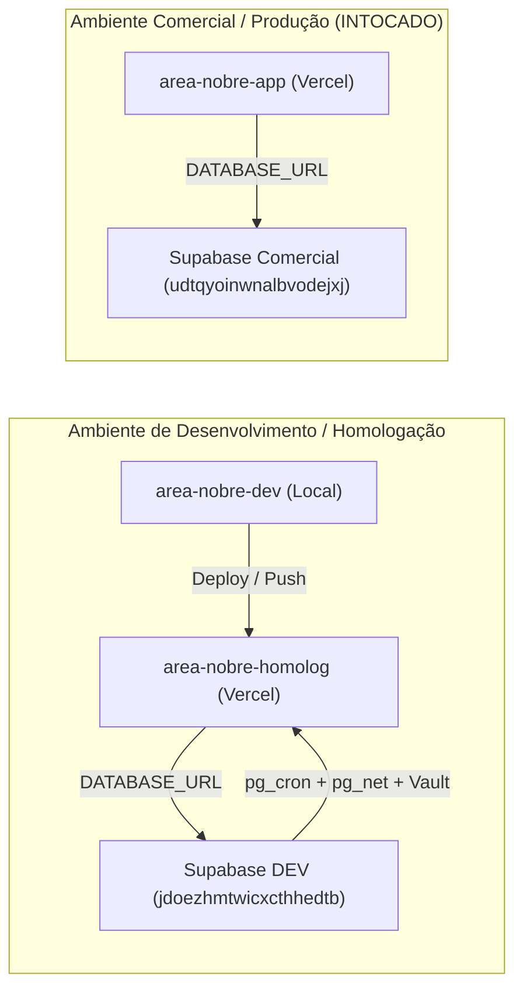

# ÁREA NOBRE — FASE 2 | BLOCO 05
## F2.B05.3H.3 — Identificação da Homologação Existente e Preparação do Agendador
### Relatório Técnico de Infraestrutura, Segurança e Configuração Operacional

---

### 1. Resumo Executivo

Em conformidade com a etapa **F2.B05.3H.3**, realizou-se a auditoria diagnóstica para localização precisa do projeto de homologação existente (`area-nobre-homolog`), a viabilidade do agendador automático perante as restrições do plano Vercel Hobby e o plano de transição seguro utilizando os recursos nativos do Supabase DEV.

A checagem foi conduzida em modo estritamente de leitura: **nenhum commit, push, deploy, modificação de variáveis remotas ou ativação de extensões foi realizada**.

O ambiente local foi validado com **100% de sucesso no build de produção** e tipagem TypeScript sem erros.

---

### 2. Localização e Propriedade do Projeto Vercel

#### 2.1. Diagnóstico de Contas e Acesso
- **Projeto Alvo**: `area-nobre-homolog`
- **Domínio Atribuído**: `https://area-nobre-homolog.vercel.app`
- **Repositório Git Vinculado**: `https://github.com/areanobreapp/area-nobre-app.git` (Conta / Organização: **`areanobreapp`**).
- **Conta Atual Autenticada na CLI Local**:
  - Usuário: `fescopan-7549`
  - Equipe / Escopo: `guilherme-reis-projects1`
  - Plano: **Hobby (Gratuito)**

#### 2.2. Motivo da Não Localização Inicial e Ação Necessária
O comando `vercel project ls` executado sob o escopo `guilherme-reis-projects1` listou apenas o projeto pessoal `fescopan-simulador-arranjos`. 

O projeto `area-nobre-homolog` pertence à conta/equipe oficial da **Área Nobre** (`areanobreapp`). Para inspecionar ou realizar comandos via CLI no projeto de homologação oficial:
1. É necessário autenticar a Vercel CLI com a conta oficial da Área Nobre (`npx vercel login` $\rightarrow$ selecionar a conta `areanobreapp` ou e-mail `areanobreapp@gmail.com`), ou
2. Utilizar um Token de Acesso Pessoal (`VERCEL_TOKEN`) com permissão sobre o escopo `areanobreapp`, ou
3. Convidar a conta `fescopan-7549` como membro/desenvolvedor da equipe oficial `areanobreapp`.

> [!IMPORTANT]
> **Preservação do Projeto Existente**: Em hipótese alguma deve ser criado um projeto homônimo ou duplicado sob a conta pessoal `guilherme-reis-projects1`. O projeto oficial `area-nobre-homolog` existente deve ser preservado e utilizado.

---

### 3. Estratégia do Agendador e Extensões no Supabase DEV

#### 3.1. Análise de Limitações do Plano Vercel Hobby
Em contas no plano **Hobby**, a Vercel **restringe a frequência de cron jobs a no máximo 1 execução diária** (`0 0 * * *`). A tentativa de realizar deploy com a expressão horária `"schedule": "0 * * * *"` resulta em falha de build ou recusa de agendamento na plataforma da Vercel.

#### 3.2. Auditoria de Extensões no Supabase DEV (`jdoezhmtwicxcthhedtb`)
A consulta aos metadados do PostgreSQL (`pg_available_extensions`) revelou:

| Extensão | Versão Disponível | Status Atual | Função / Finalidade |
|---|---|---|---|
| **`supabase_vault`** | `0.3.1` | **INSTALADA (`0.3.1`)** | Armazenamento criptografado de segredos com isolamento de chave no PostgreSQL. |
| **`pg_cron`** | `1.6.4` | Disponível (não habilitada) | Agendador de tarefas em segundo plano baseado em cron syntax. |
| **`pg_net`** | `0.20.4` | Disponível (não habilitada) | Cliente HTTP assíncrono não-bloqueante para PostgreSQL. |

#### 3.3. Arquitetura Proposta: Agendamento Seguro via Supabase DEV + Vault
Para obter execução horária estrita sem qualquer custo adicional e sem depender do plano da Vercel:

1. **Armazenamento Seguro do Segredo no Vault**:
   O segredo `CRON_SECRET` não deve constar em arquivos de código, scripts versionados ou migrações. O Supabase DEV já possui o `supabase_vault` ativo:
   ```sql
   -- Executado manualmente pelo administrador via Supabase SQL Editor (sem versionar o token):
   SELECT vault.create_secret('SEGREDO_DE_ALTA_ENTROPIA_AQUI', 'cron_secret');
   ```

2. **Agendamento Horário sem Exposição de Segredo**:
   Uma vez habilitadas as extensões `pg_cron` e `pg_net` no Supabase DEV, o agendamento recupera o segredo de forma dinâmica e segura através da view `vault.decrypted_secrets`:
   ```sql
   -- Rotina horária chamando exclusivamente o ambiente de homologação:
   SELECT cron.schedule(
     'process-waitlist-expirations-hourly',
     '0 * * * *',
     $$
     SELECT net.http_get(
       url := 'https://area-nobre-homolog.vercel.app/api/waitlist/process-expirations',
       headers := jsonb_build_object(
         'Authorization', 'Bearer ' || (SELECT decrypted_secret FROM vault.decrypted_secrets WHERE name = 'cron_secret' LIMIT 1)
       )
     );
     $$
   );
   ```

---

### 4. Ajustes Locais Realizados

#### 4.1. Ajuste Seguro em `vercel.json`
Para prevenir que um deploy em conta Hobby seja rejeitado pela Vercel devido ao agendamento horário, o arquivo local [`vercel.json`](file:///c:/Guilherme/Corretora%20Daiane/area-nobre-dev/vercel.json) foi higienizado, removendo a diretiva `crons`:
```json
{
  "$schema": "https://openapi.vercel.sh/vercel.json"
}
```
- **Integridade da Rota**: A rota de processamento de expirações ([`src/app/api/waitlist/process-expirations/route.ts`](file:///c:/Guilherme/Corretora%20Daiane/area-nobre-dev/src/app/api/waitlist/process-expirations/route.ts)) permanece **100% funcional**, atendendo a `GET` e `POST`, protegida por `CRON_SECRET` com comparação *timing-safe* e por autenticação administrativa.
- **Vantagem**: O deploy da homologação ocorrerá sem erros de validação de plano na Vercel, delegando a periodicidade ao agendador nativo do Supabase DEV.

---

### 5. Verificação Estrita de Isolamento de Ambientes

Confirmou-se o isolamento absoluto entre os ecossistemas:



- **Homologação $\rightarrow$ Supabase DEV**: Variáveis de ambiente configuradas no arquivo `.env` local e apontamentos de homologação utilizam exclusivamente o projeto `jdoezhmtwicxcthhedtb`.
- **Comercial $\rightarrow$ Supabase Comercial**: O projeto comercial `area-nobre-app` e o banco comercial `udtqyoinwnalbvodejxj` permanecem completamente desconectados da branch `feature/compartilhamento-melhorias`.
- **URL do Agendador**: A rotina cron proposta faz chamadas exclusivamente para `https://area-nobre-homolog.vercel.app`, não havendo nenhum tráfego direcionado ao domínio comercial.

---

### 6. Validação Técnica Local

- **Compilação TypeScript**: `npx tsc --noEmit` $\rightarrow$ **0 erros** (exit code 0).
- **Build de Produção**: `npm run build` $\rightarrow$ **Sucesso absoluto** (exit code 0).
  - 54 rotas de API e 29 páginas renderizadas e otimizadas.
- **Integridade do Banco DEV**:
  - `User`: 4 registros originais.
  - `Property`: 3 registros originais.
  - `PhysicalProperty`: 0 resíduos.
  - `PropertyWaitlist`: 0 resíduos.
  - Zero migrações pendentes (`Database schema is up to date!`).

---

### 7. Riscos, Pendências e Procedimento Posterior de Publicação

#### Pendências para Publicação:
1. **Autenticação Vercel**: Realizar login na Vercel com a conta proprietária do projeto `area-nobre-homolog` (`areanobreapp`).
2. **Variável na Vercel**: Adicionar a variável `CRON_SECRET` no painel da Vercel (Environment Variables $\rightarrow$ Preview/Homolog).
3. **Ativação do Cron no Supabase DEV**: Após o deploy, executar a criação do segredo no Vault e o agendamento `pg_cron` no SQL Editor do Supabase DEV.

#### Procedimento Recomendado para Publicação (Sob Autorização):
```bash
# 1. Commit unificado de todas as alterações do Bloco 05:
git add prisma/schema.prisma prisma/migrations/
git add src/
git add vercel.json
git add *.md
git commit -m "feat(f2-b05): integrate slot limits, shared pricing, disputes, waitlist, grouping and homologation hardening"

# 2. Push para a branch de homologação no GitHub:
git push origin feature/compartilhamento-melhorias

# 3. Disparar / Acompanhar o deploy no projeto 'area-nobre-homolog' na Vercel.
```

