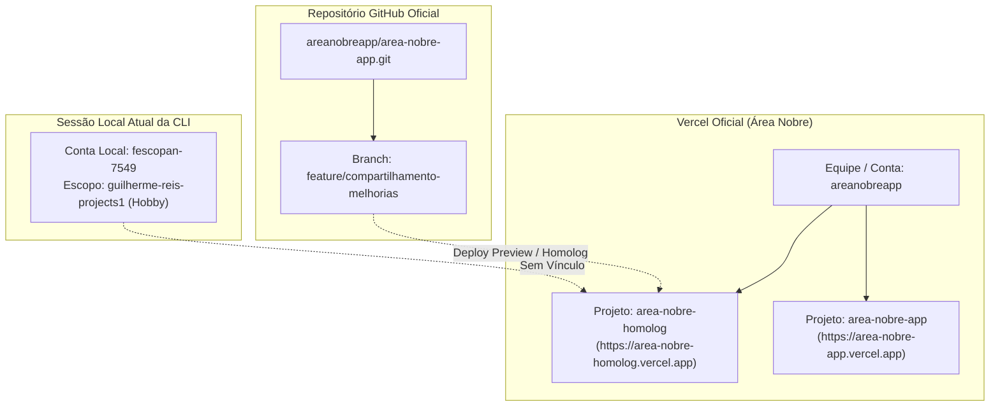
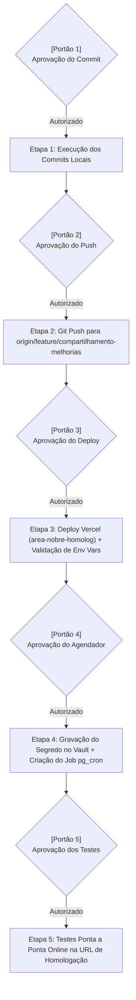

# ÁREA NOBRE — FASE 2 | BLOCO 05
## F2.B05.3H.4 — Preparação Final do Git e Acesso à Vercel
### Relatório de Engenharia, Organização de Versionamento e Roteiro de Publicação

---

### 1. Resumo Executivo

Este documento consolida a preparação final para a publicação das entregas do **Bloco 05 (F2.B05.1B até F2.B05.3H.3)** no ambiente de homologação (`area-nobre-homolog`).

A auditoria cobriu a identificação do acesso Vercel, a separação metódica dos arquivos para versionamento, a análise de resiliência e segurança do agendador `pg_cron` com Supabase Vault, e a conferência de isolamento absoluto entre os ambientes DEV e comercial.

Em conformidade estrita com as diretrizes da etapa:
- **Nenhum commit foi executado.**
- **Nenhum push foi executado.**
- **Nenhum deploy foi disparado.**
- **Nenhuma extensão ou rotina agendada remota foi criada.**
- **O ambiente comercial permanece 100% intocado e isolado.**

---

### 2. Identificação e Diagnóstico de Acesso à Vercel

#### 2.1. Metadados do Projeto de Homologação Existente
- **Nome do Projeto**: `area-nobre-homolog`
- **URL Pública Oficial**: `https://area-nobre-homolog.vercel.app`
- **Proprietária na Vercel**: Equipe / Conta **`areanobreapp`**
- **Repositório Git Conectado**: `https://github.com/areanobreapp/area-nobre-app.git`
- **Branch de Trabalho**: `feature/compartilhamento-melhorias`
- **Ambiente de Destino**: *Preview / Staging* (Homologação)

#### 2.2. Procedimento de Autenticação Necessário
A sessão atual da Vercel CLI nesta máquina local pertence ao usuário pessoal `fescopan-7549` (`guilherme-reis-projects1`). Para que a CLI local possa interagir diretamente com o projeto `area-nobre-homolog` sem recorrer exclusivamente ao painel web, o desenvolvedor dispõe de duas alternativas:

1. **Autenticação Direta**:
   Executar no terminal local `npx vercel login` e autenticar com o e-mail ou credenciais da organização `areanobreapp` (`areanobreapp@gmail.com`).
2. **Convite de Membro na Vercel**:
   Acessar `vercel.com/areanobreapp/settings/members` e convidar o usuário `fescopan-7549` como membro da equipe oficial da Área Nobre.
3. **Deploy Contínuo via Git (Recomendado)**:
   Como o repositório GitHub `areanobreapp/area-nobre-app` já está vinculado ao projeto `area-nobre-homolog` na Vercel, o deploy de homologação ocorre de forma automática e segura assim que o `git push` for autorizado, dispensando a necessidade de comandos manuais da CLI Vercel na máquina local.

> [!IMPORTANT]
> **Preservação de Escopo**: O projeto `area-nobre-homolog` oficial existente na conta `areanobreapp` será preservado. Nenhum projeto paralelo será criado.

---

### 3. Preparação do Git e Separação de Arquivos

Auditaram-se todos os arquivos modificados e não rastreados desde o último commit (`94200b9`):

#### 3.1. Classificação dos Arquivos

| Categoria | Arquivos Envolvidos | Destino no Versionamento |
|---|---|---|
| **Schema e Migrações** | `prisma/schema.prisma` `prisma/migrations/20261110005626_add_shared_physical_property_pricing/migration.sql` `prisma/seed-dev.mjs` | **Versionar** (Commit 1) |
| **Núcleo de Negócio (Services)** | `src/lib/listing-slot-service.ts` `src/lib/price-revision-service.ts` `src/lib/waitlist-service.ts` `src/lib/geo/property-grouping.ts` `src/lib/auth.ts` `src/lib/matching/normalizer.ts` `src/lib/matching/service.ts` | **Versionar** (Commit 1 e 2) |
| **Rotas de API** | `src/app/api/properties/[id]/route.ts` `src/app/api/properties/route.ts` `src/app/api/properties/[id]/price/route.ts` `src/app/api/properties/[id]/price-revisions/route.ts` `src/app/api/properties/[id]/waitlist/route.ts` `src/app/api/price-revisions/**` `src/app/api/admin/disputes/**` `src/app/api/waitlist/**` `src/app/api/searches/[id]/route.ts` `src/app/api/buildings/[id]/units/route.ts` | **Versionar** (Commit 2) |
| **Interfaces e Componentes** | `src/app/imoveis/[id]/page.tsx` `src/app/imoveis/page.tsx` `src/app/buscas/[id]/page.tsx` `src/app/page.tsx` `src/app/admin/page.tsx` `src/components/HomeMap.tsx` `src/components/SearchMatchesMap.tsx` `src/components/PropertyForm.tsx` `src/components/properties/**` `src/components/admin/**` | **Versionar** (Commit 3) |
| **Infraestrutura** | `vercel.json` (higienizado sem cron incompatível) | **Versionar** (Commit 4) |
| **Documentação Técnica** | `f2_b05_*.md` (relatórios das etapas F2.B05.3G.1 até F2.B05.3H.4) | **Versionar** (Commit 4) |
| **Scripts e Testes Temporários** | `scratch/test_f2_b05_*.ts` | **Ignorados** via `.gitignore` |
| **Credenciais e Ambiente** | `.env`, `.env.local` | **Ignorados** via `.gitignore` |

#### 3.2. Proposta de Organização dos Commits (4 Commits Lógicos)
Para que o histórico Git da homologação seja limpo, legível e auditável:

- **Commit 1**: `feat(f2-b05): shared physical property pricing and transactional slot service`
  *(Schema, migração, ListingSlotService, PriceRevisionService, WaitlistService, Auth)*
- **Commit 2**: `feat(f2-b05): property slot, price revision, dispute and waitlist APIs`
  *(Todas as 18 novas rotas de API e integrações transacionais)*
- **Commit 3**: `feat(f2-b05): shared property UI, map grouping, search matches and broker selection`
  *(Componentes visuais, drawers, abas, badges de co-listagem e agrupamento geográfico)*
- **Commit 4**: `docs(f2-b05): add technical audit reports and staging vercel configuration`
  *(vercel.json e relatórios de homologação f2_b05_*.md)*

---

### 4. Segurança, Resiliência e Isolamento do Agendador

#### 4.1. Arquitetura `pg_cron` + `pg_net` + Supabase Vault
- **Armazenamento de Segredo com Zero Exposição**:
  O token `CRON_SECRET` será gravado no `supabase_vault` (extensão `0.3.1` já instalada no Supabase DEV).
  Nenhum script versionado ou log expõe o segredo.
- **Chamada Segura**:
  A cada 60 minutos, o `pg_cron` invoca a função `net.http_get`:
  - **URL Alvo Exclusiva**: `https://area-nobre-homolog.vercel.app/api/waitlist/process-expirations`
  - **Cabeçalho de Autenticação**: `Authorization: Bearer <recuperado via vault.decrypted_secrets>`
- **Tratamento de Falhas e Timeouts**:
  - `pg_net` opera de forma **totalmente assíncrona** (non-blocking). Se a rota demorar ou houver falha de rede temporária, o processo do banco de dados não sofre travamento.
  - A rota na Vercel utiliza **bloqueio pessimista PostgreSQL (`SELECT ... FOR UPDATE`)**, garantindo que mesmo se duas requisições chegarem simultaneamente, uma aguardará a outra, mantendo a integridade das 3 vagas e a ordem estrita da fila FIFO.
  - A rota é **estritamente idempotente**: chamadas repetidas sem novas ofertas vencidas retornam `processedCount: 0, promotedCount: 0` sem efeito colateral.

#### 4.2. Isolamento Absoluto dos Ambientes DEV e Comercial
- O banco Supabase DEV (`jdoezhmtwicxcthhedtb`) e a URL de homologação (`area-nobre-homolog.vercel.app`) operam em circuito fechado.
- O banco comercial (`udtqyoinwnalbvodejxj`) e o domínio comercial (`area-nobre-app.vercel.app`) não recebem nenhuma requisição, chamada de webhook ou alteração de schema.

---

### 5. Conferência Final de Integridade Local

- **Branch Ativa**: `feature/compartilhamento-melhorias`.
- **Compilação TypeScript**: `npx tsc --noEmit` $\rightarrow$ **0 erros** (exit code 0).
- **Build de Produção**: `npm run build` $\rightarrow$ **Sucesso absoluto** (exit code 0, 54 rotas de API e 29 páginas).
- **Status do Banco DEV**:
  - 9 migrações aplicadas (`Database schema is up to date!`).
  - 4 usuários originais e 3 anúncios originais 100% preservados.
  - 0 registros residuais em `PhysicalProperty` e `PropertyWaitlist`.

---

### 6. Roteiro de Publicação com Pontos de Aprovação Explícitos

A publicação deve seguir estritamente o roteiro em 5 etapas independentes abaixo. **Nenhuma ação deve ser iniciada sem sua aprovação prévia para a respectiva etapa**:

#### Etapa 1: Commit Local
- **Ação**: Adicionar os arquivos de código, schema, migrações, `vercel.json` e documentações, executando os commits organizados.
- **Portão de Aprovação 1**: Requer aprovação do usuário para executar `git commit`.

#### Etapa 2: Push para o Repositório Remoto
- **Ação**: Enviar a branch `feature/compartilhamento-melhorias` para `origin`.
- **Portão de Aprovação 2**: Requer aprovação do usuário para executar `git push`.

#### Etapa 3: Deploy no Projeto de Homologação Existente
- **Ação**: Acompanhar o build automático do projeto `area-nobre-homolog` na Vercel e validar que as variáveis de ambiente (`DATABASE_URL`, `DIRECT_URL`, `SUPABASE_URL`, `SUPABASE_SERVICE_ROLE_KEY`, `CRON_SECRET`, `JWT_SECRET`, `APP_PUBLIC_URL`) estão cadastradas.
- **Portão de Aprovação 3**: Requer aprovação do usuário para disparar/validar o deploy na Vercel.

#### Etapa 4: Configuração e Ativação do Agendador no Supabase DEV
- **Ação**: Habilitar as extensões `pg_cron` e `pg_net` no Supabase DEV, cadastrar o `cron_secret` no `supabase_vault` e agendar a rotina horária apontando para `https://area-nobre-homolog.vercel.app/api/waitlist/process-expirations`.
- **Portão de Aprovação 4**: Requer aprovação do usuário para aplicar os comandos SQL no Supabase DEV.

#### Etapa 5: Testes Online de Homologação
- **Ação**: Acessar `https://area-nobre-homolog.vercel.app` e validar os fluxos completos de 3 corretores, preço único compartilhado, fila de espera, convocação de 48h e mapa consolidado em ambiente web real.
- **Portão de Aprovação 5**: Requer aprovação do usuário para encerramento do Bloco 05.

