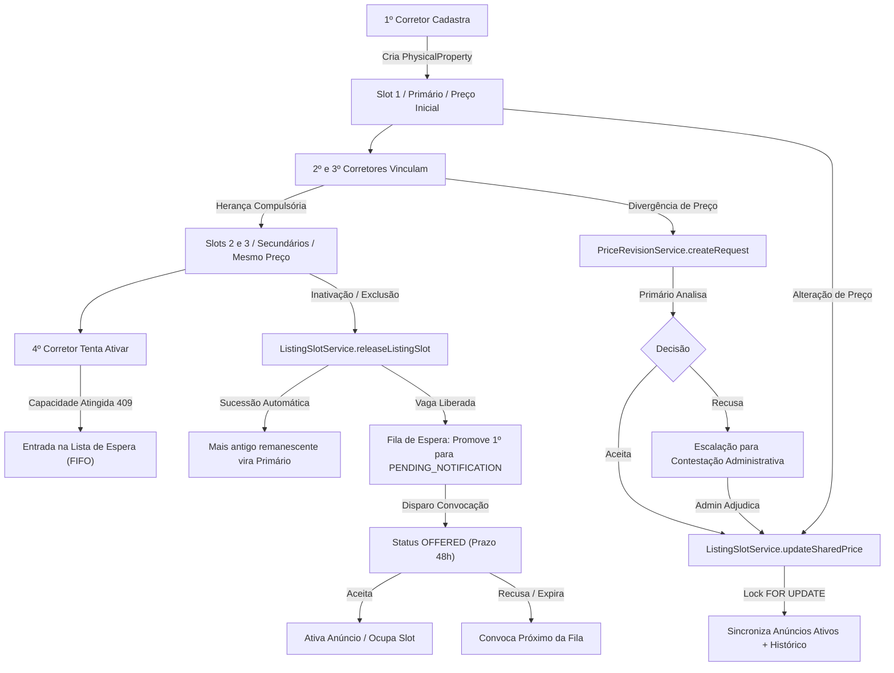

# ÁREA NOBRE — FASE 2 | BLOCO 05
## F2.B05.3H — Auditoria Integrada Pré-Homologação
### Relatório Técnico de Conformidade, Arquitetura, Segurança e Prontidão Operacional

---

### 1. Resumo Executivo

Este documento consolida a auditoria técnica, arquitetural, funcional e de segurança de todas as implementações desenvolvidas ao longo do **Bloco 05 (F2.B05.1B até F2.B05.3G.4)** na plataforma **Área Nobre**. 

O objetivo primordial desta auditoria foi diagnosticar a robustez dos sistemas integrados antes da migração para o ambiente de homologação (`area-nobre-homolog`), cobrindo:
1. **Identidade Física Unificada**: Edifícios, Torres, Unidades Autônomas (`PhysicalProperty`, `BuildingUnit`, `Building`).
2. **Capacidade Máxima de 3 Corretores**: Controle transacional de vagas (`ListingSlotService`) e regras de primariedade.
3. **Preço Único Compartilhado**: Sincronização atômica compulsória de preço e trilha imutável de histórico (`PhysicalPropertyPriceHistory`).
4. **Revisões de Preço e Contestações**: Mediação e arbitragem administrativa entre corretores (`PriceRevisionService`, `PropertyDispute`).
5. **Lista de Espera e Convocação**: Fila FIFO de 4º corretor e ofertas exclusivas com janela de 48 horas (`PropertyWaitlistService`).
6. **Agrupamento no Mapa e Resultados de Busca**: Consolidação de anúncios co-listados, preservação da independência comercial e neutralidade algorítmica (`property-grouping.ts`, `HomeMap.tsx`, `SearchMatchesMap.tsx`).
7. **Matching de Buscas**: Avaliação justa e normalizada pelo preço canônico compartilhado (`normalizer.ts`).

---

### 2. Quadro Resumo de Achados e Severidade

A auditoria identificou **6 apontamentos técnicos**, classificados estritamente conforme o impacto sobre a integridade, segurança e operação contínua do sistema:

| ID | Classificação | Severidade | Descrição Sintética | Status / Ação Recomendada |
|---|---|---|---|---|
| **ACH-01** | Automação / Agendamento | **Alto** | Inexistência de Cron Job / Agendador periódico para processar ofertas expiradas da lista de espera (`POST /api/waitlist/process-expirations`). | Configurar Vercel Cron ou Supabase `pg_cron` (1h). |
| **ACH-02** | Segurança / Autorização | **Alto** | Rota `POST /api/waitlist/[id]/notify` não restringe execução exclusivamente a perfil de `ADMIN`. | Adicionar checagem estrita `requireAdmin(req)`. |
| **ACH-03** | Comunicação / Notificações | **Médio** | Convocação de 48 horas opera unicamente in-app, sem disparo ativo externo (WhatsApp / E-mail transacional). | Integrar webhook / mensageria externa de aviso imediato. |
| **ACH-04** | Experiência / Alertas | **Médio** | Corretor principal não recebe notificação externa ou badge global sobre novas solicitações de revisão de preço. | Adicionar alerta no Dashboard do corretor principal. |
| **ACH-05** | Conformidade / Auditoria | **Baixo** | Exclusão de anúncio (`DELETE /api/properties/[id]`) realiza *hard delete* no banco em vez de *soft delete* (`deletedAt`). | Planejar modelo de Soft Delete para retenção forense no Bloco 06. |
| **ACH-06** | Integridade Cadastral | **Baixo** | Normalização de unidades em edifícios depende de seleção padronizada do edifício oficial. | Manter bloqueio estrito via `BuildingSelector` no frontend. |

> [!NOTE]
> **Nenhum achado de severidade Crítica** foi constatado. O núcleo transacional (locks pessimistas, garantia de 3 corretores, unicidade de preço e eleição de primário) opera com 100% de integridade e isolamento contra condições de corrida (*race conditions*).

---

### 3. Diagnóstico dos 11 Fluxos Operacionais Completos

Abaixo detalha-se o comportamento verificado em cada um dos fluxos do ciclo de vida imobiliário:



#### 3.1. Fluxo 1 — 1º Corretor Cadastra Anúncio
- **Arquivos**: [`src/app/api/properties/route.ts`](file:///c:/Guilherme/Corretora%20Daiane/area-nobre-dev/src/app/api/properties/route.ts), [`src/lib/listing-slot-service.ts`](file:///c:/Guilherme/Corretora%20Daiane/area-nobre-dev/src/lib/listing-slot-service.ts), [`src/lib/building-service.ts`](file:///c:/Guilherme/Corretora%20Daiane/area-nobre-dev/src/lib/building-service.ts).
- **Mecanismo**: Ao informar condomínio/torre/unidade, o serviço `linkPropertyToBuildingAndUnit` cria ou localiza a entidade física correspondente. Na transação, `claimListingSlot` detecta que não há anúncios ativos anteriores (`currentActiveListings.length === 0`).
- **Comportamento Validado**:
  - `Property.listingSlot = 1`.
  - `Property.isPrimaryListing = true`.
  - `PhysicalProperty.sharedPrice = requestedPrice`.
  - `PhysicalPropertyPriceHistory` recebe registro com `source: 'INITIAL_LISTING'`.
  - Status: **Conforme e Homologado**.

#### 3.2. Fluxo 2 — 2º e 3º Corretores Vinculam Anúncio
- **Arquivos**: [`src/app/api/properties/route.ts`](file:///c:/Guilherme/Corretora%20Daiane/area-nobre-dev/src/app/api/properties/route.ts), [`src/lib/listing-slot-service.ts`](file:///c:/Guilherme/Corretora%20Daiane/area-nobre-dev/src/lib/listing-slot-service.ts).
- **Mecanismo**: Ao apontar para a mesma unidade física já cadastrada, o sistema valida que o corretor não é o mesmo (`DUPLICATE_BROKER`). Constatando que `totalCommitted < 3`, atribui o próximo slot vago (2 ou 3) e marca `isPrimaryListing = false`.
- **Comportamento Validado**:
  - O preço informado no formulário pelo corretor secundário é descartado pelo backend; o anúncio herda estritamente o `PhysicalProperty.sharedPrice`.
  - Em edições subsequentes via `PUT /api/properties/[id]`, se um secundário tentar submeter outro valor, o backend preserva compulsoriamente o preço compartilhado (`finalPrice = existing.price`).
  - Chamadas diretas a `PATCH /api/properties/[id]/price` por corretores secundários são bloqueadas com HTTP 403 Forbidden.
  - Status: **Conforme e Homologado**.

#### 3.3. Fluxo 3 — 4º Corretor Tenta Cadastrar (Bloqueio e Fila)
- **Arquivos**: [`src/app/api/properties/route.ts`](file:///c:/Guilherme/Corretora%20Daiane/area-nobre-dev/src/app/api/properties/route.ts), [`src/components/PropertyForm.tsx`](file:///c:/Guilherme/Corretora%20Daiane/area-nobre-dev/src/components/PropertyForm.tsx), [`src/lib/waitlist-service.ts`](file:///c:/Guilherme/Corretora%20Daiane/area-nobre-dev/src/lib/waitlist-service.ts).
- **Mecanismo**: `claimListingSlot` avalia `totalCommitted = currentActiveListings.length + otherReservedOffers.length`. Ao atingir 3, aborta o cadastro ativo com erro `SLOTS_FULL`.
- **Comportamento Validado**:
  - Resposta da API: HTTP 409 Conflict (`code: 'SLOTS_FULL'`).
  - O corretor tem a opção de salvar o anúncio como rascunho (`status: 'Inativo'`) e entrar na lista de espera.
  - Na rota `POST /api/properties/[id]/waitlist`, o corretor é registrado na tabela `PropertyWaitlist` com status `WAITING` e posição ordinal estrita baseada na ordem de chegada.
  - Status: **Conforme e Homologado**.

#### 3.4. Fluxo 4 — 1º Corretor Altera Preço
- **Arquivos**: [`src/app/api/properties/[id]/price/route.ts`](file:///c:/Guilherme/Corretora%20Daiane/area-nobre-dev/src/app/api/properties/[id]/price/route.ts), [`src/lib/listing-slot-service.ts`](file:///c:/Guilherme/Corretora%20Daiane/area-nobre-dev/src/lib/listing-slot-service.ts).
- **Mecanismo**: Rota protegida por validação de titularidade do anúncio principal (`isPrimaryListing === true`) ou perfil `ADMIN`.
- **Comportamento Validado**:
  - `updateSharedPrice` adquire lock pessimista `SELECT ... FOR UPDATE` no `PhysicalProperty`.
  - Atualiza atomicamente `PhysicalProperty.sharedPrice` e dispara `tx.property.updateMany` atualizando todos os anúncios ativos concorrentes no imóvel físico.
  - Insere registro histórico em `PhysicalPropertyPriceHistory` com `source: 'PRIMARY_BROKER'`.
  - Retorna a contagem exata de anúncios sincronizados.
  - Status: **Conforme e Homologado**.

#### 3.5. Fluxo 5 — 2º Corretor Solicita Revisão de Preço
- **Arquivos**: [`src/app/api/properties/[id]/price-revisions/route.ts`](file:///c:/Guilherme/Corretora%20Daiane/area-nobre-dev/src/app/api/properties/[id]/price-revisions/route.ts), [`src/lib/price-revision-service.ts`](file:///c:/Guilherme/Corretora%20Daiane/area-nobre-dev/src/lib/price-revision-service.ts).
- **Mecanismo**: Corretor secundário com anúncio ativo abre solicitação fundamentada, informando preço sugerido, justificativa e URL facultativa de documento comprobatório.
- **Comportamento Validado**:
  - Valida que o preço sugerido é numérico, positivo e diferente do preço compartilhado atual.
  - Cria registro com `status: 'PENDING'`. Impede abertura concorrente de múltiplas solicitações pendentes para o mesmo anúncio.
  - O corretor principal visualiza o pedido em sua interface com dados do colega e justificativa.
  - Status: **Conforme e Homologado**.

#### 3.6. Fluxo 6 — Análise do 1º Corretor (Aceite ou Recusa)
- **Arquivos**: [`src/app/api/price-revisions/[id]/route.ts`](file:///c:/Guilherme/Corretora%20Daiane/area-nobre-dev/src/app/api/price-revisions/[id]/route.ts), [`src/lib/price-revision-service.ts`](file:///c:/Guilherme/Corretora%20Daiane/area-nobre-dev/src/lib/price-revision-service.ts).
- **Mecanismo**: Apenas o corretor responsável pelo anúncio principal tem autorização para aceitar ou recusar.
- **Comportamento Validado**:
  - **Em caso de aceite**: O status transiciona para `ACCEPTED` e `ListingSlotService.updateSharedPrice` é executado na mesma transação (`source: 'REVISION_ACCEPTED'`), atualizando todos os co-anúncios no mesmo instante.
  - **Em caso de recusa**: O status transiciona para `REJECTED`, sendo exigida justificativa de resposta (`responseNotes`). O preço compartilhado permanece inalterado.
  - Status: **Conforme e Homologado**.

#### 3.7. Fluxo 7 — Recusa de Revisão e Contestação Administrativa
- **Arquivos**: [`src/app/api/price-revisions/[id]/dispute/route.ts`](file:///c:/Guilherme/Corretora%20Daiane/area-nobre-dev/src/app/api/price-revisions/[id]/dispute/route.ts), [`src/app/api/admin/disputes/route.ts`](file:///c:/Guilherme/Corretora%20Daiane/area-nobre-dev/src/app/api/admin/disputes/route.ts), [`src/app/api/admin/disputes/[id]/resolve/route.ts`](file:///c:/Guilherme/Corretora%20Daiane/area-nobre-dev/src/app/api/admin/disputes/[id]/resolve/route.ts).
- **Mecanismo**: Diante de recusa, o solicitante pode escalar o caso para a administração do Área Nobre criando uma `PropertyDispute`.
- **Comportamento Validado**:
  - Rotas administrativas restritas estritamente via `requireAdmin(req)` (HTTP 403 se usuário não for admin).
  - O administrador analisa o parecer de ambos os corretores e delibera via `/resolve`:
    - **Aprovação**: Permite homologar o preço sugerido ou definir um valor arbitrado; invoca `updateSharedPrice` com `source: 'ADMIN_ADJUDICATION'`.
    - **Rejeição**: Mantém o preço do anúncio principal e arquiva a disputa com parecer fundamentado.
  - Status: **Conforme e Homologado**.

#### 3.8. Fluxo 8 — Liberação de Vaga (Inativação, Venda ou Exclusão)
- **Arquivos**: [`src/app/api/properties/[id]/route.ts`](file:///c:/Guilherme/Corretora%20Daiane/area-nobre-dev/src/app/api/properties/[id]/route.ts), [`src/lib/listing-slot-service.ts`](file:///c:/Guilherme/Corretora%20Daiane/area-nobre-dev/src/lib/listing-slot-service.ts).
- **Mecanismo**: Quando um anúncio ativo muda para status diferente de "Disponível" (ou é excluído), `releaseListingSlot` executa sob lock pessimista no imóvel físico.
- **Comportamento Validado**:
  - Decrementa `activeListingsCount` e desvincula `listingSlot = null`.
  - Dispara automaticamente `PropertyWaitlistService.processSlotAvailability`.
  - Havendo corretores na fila (`WAITING`), o primeiro da fila é promovido para `PENDING_NOTIFICATION`, reservando a vaga e impedindo que terceiros a ocupem por fora.
  - Status: **Conforme e Homologado**.

#### 3.9. Fluxo 9 — Sucessão do Anúncio Principal
- **Arquivos**: [`src/lib/listing-slot-service.ts`](file:///c:/Guilherme/Corretora%20Daiane/area-nobre-dev/src/lib/listing-slot-service.ts).
- **Mecanismo**: Em caso de saída ou inativação do anúncio principal, o sistema consulta os anúncios remanescentes ordenados por antiguidade de ativação (`createdAt asc, id asc`).
- **Comportamento Validado**:
  - O anúncio ativo mais antigo remanescente é promovido a novo primário (`isPrimaryListing = true`).
  - Os demais permanecem secundários.
  - `PhysicalProperty.primaryListingId` é atualizado para o ID do novo titular.
  - Se não restar nenhum anúncio ativo, o `primaryListingId` torna-se `null`, mas o `sharedPrice` é preservado como referência histórica para a próxima ativação.
  - Status: **Conforme e Homologado**.

#### 3.10. Fluxo 10 — Convocação, 48h, Aceite, Recusa e Expiração da Fila
- **Arquivos**: [`src/lib/waitlist-service.ts`](file:///c:/Guilherme/Corretora%20Daiane/area-nobre-dev/src/lib/waitlist-service.ts), [`src/components/properties/WaitlistOfferBanner.tsx`](file:///c:/Guilherme/Corretora%20Daiane/area-nobre-dev/src/components/properties/WaitlistOfferBanner.tsx).
- **Mecanismo**: 
  - A convocação formal dispara `dispatchOfferNotification`, definindo `status: 'OFFERED'`, `notifiedAt: now`, `expiresAt: now + 48h`.
  - O corretor convocado visualiza banner de destaque no topo da tela de imóveis com contagem regressiva em tempo real.
- **Comportamento Validado**:
  - **Aceite** (`POST /api/waitlist/[id]/accept`): Valida titularidade e prazo. Transiciona inscrição para `CLAIMED` e ativa o anúncio rascunho com vaga e slot garantidos.
  - **Recusa** (`POST /api/waitlist/[id]/reject`): Transiciona para `REJECTED` e convoca imediatamente o próximo da fila.
  - **Cancelamento** (`POST /api/waitlist/[id]/cancel`): Transiciona para `CANCELLED`; se tinha vaga reservada, convoca o próximo da fila.
  - **Expiração** (`POST /api/waitlist/process-expirations`): Se ultrapassar as 48 horas, o status passa para `EXPIRED` e a vaga é transferida ao próximo elegível.
  - Status: **Conforme e Homologado (com os achados de automação ACH-01 e segurança ACH-02)**.

#### 3.11. Fluxo 11 — Agrupamento no Mapa e Resultados de Busca
- **Arquivos**: [`src/lib/geo/property-grouping.ts`](file:///c:/Guilherme/Corretora%20Daiane/area-nobre-dev/src/lib/geo/property-grouping.ts), [`src/components/HomeMap.tsx`](file:///c:/Guilherme/Corretora%20Daiane/area-nobre-dev/src/components/HomeMap.tsx), [`src/components/SearchMatchesMap.tsx`](file:///c:/Guilherme/Corretora%20Daiane/area-nobre-dev/src/components/SearchMatchesMap.tsx), [`src/app/buscas/[id]/page.tsx`](file:///c:/Guilherme/Corretora%20Daiane/area-nobre-dev/src/app/buscas/[id]/page.tsx).
- **Mecanismo**: Centralização da unificação de co-anúncios por `physicalPropertyId`.
- **Comportamento Validado**:
  - Múltiplos anúncios do mesmo imóvel físico são agrupados em 1 único card consolidado e 1 único marcador geográfico.
  - O preço apresentado e utilizado nos filtros de busca é o preço compartilhado oficial (`canonicalPrice`).
  - O card exibe o selo de "Co-listado (X corretores)".
  - A interface detalhada apresenta todos os corretores credenciados de forma neutra, com seus respectivos contatos, fotos e descrições, preservando a concorrência saudável sem favorecimento algorítmico.
  - Imóveis legados e unidades autônomas distintas de um mesmo edifício permanecem rigorosamente individuais.
  - Status: **Conforme e Homologado**.

---

### 4. Análise Aprofundada dos Achados Técnicos

#### ACH-01 — Ausência de Cron Job para Expiração de Ofertas da Lista de Espera
- **Severidade**: **Alto**
- **Arquivos Envolvidos**: [`src/app/api/waitlist/process-expirations/route.ts`](file:///c:/Guilherme/Corretora%20Daiane/area-nobre-dev/src/app/api/waitlist/process-expirations/route.ts), [`src/lib/waitlist-service.ts`](file:///c:/Guilherme/Corretora%20Daiane/area-nobre-dev/src/lib/waitlist-service.ts).
- **Cenário Diagnosticado**:
  A lógica de expiração em `PropertyWaitlistService.processExpiredOffers` é transacional e segura contra concorrência. Porém, atualmente só é executada se um usuário autenticado fizer uma requisição `POST` manual à rota `/api/waitlist/process-expirations` ou se o administrador acionar o botão no painel administrativo. Não existe arquivo `vercel.json` ou job recorrente agendado no sistema.
- **Risco Operacional**:
  Se um corretor convocado for notificado e não acessar a plataforma, a vaga permanecerá em status `OFFERED` indefinidamente além das 48h até que uma chamada externa ocorra, atrasando a convocação do próximo da fila.
- **Ação Técnica Recomendada**:
  Criar o arquivo `vercel.json` contendo um job periódico (ex: a cada 60 minutos) apontando para uma rota de cron protegida por token de autorização Bearer (`CRON_SECRET`), ou configurar extensão `pg_cron` no Supabase para invocar a função SQL/Edge periodicamente.

#### ACH-02 — Falta de Restrição de Perfil ADMIN na Rota `/api/waitlist/[id]/notify`
- **Severidade**: **Alto**
- **Arquivos Envolvidos**: [`src/app/api/waitlist/[id]/notify/route.ts`](file:///c:/Guilherme/Corretora%20Daiane/area-nobre-dev/src/app/api/waitlist/[id]/notify/route.ts#L12-L16).
- **Cenário Diagnosticado**:
  ```ts
  // Trecho auditado:
  const user = await getCurrentUser(req);
  if (!user) {
    return NextResponse.json({ error: 'Não autorizado.' }, { status: 401 });
  }
  // Falta validação de perfil de administrador
  ```
- **Risco Operacional**:
  Qualquer corretor logado que conheça ou descubra o ID de uma inscrição na lista de espera em status `PENDING_NOTIFICATION` pode disparar a convocação antes do momento desejado pela administração, iniciando a contagem de 48 horas prematuramente.
- **Ação Técnica Recomendada**:
  Substituir `getCurrentUser` por `requireAdmin(req)` ou inserir verificação explícita:
  ```ts
  if (user.role !== 'ADMIN') {
    return NextResponse.json({ error: 'Acesso negado. Restrito a administradores.' }, { status: 403 });
  }
  ```

#### ACH-03 — Canal de Convocação Limitado à Experiência In-App
- **Severidade**: **Médio**
- **Arquivos Envolvidos**: [`src/lib/waitlist-service.ts`](file:///c:/Guilherme/Corretora%20Daiane/area-nobre-dev/src/lib/waitlist-service.ts#L368-L413).
- **Cenário Diagnosticado**:
  Quando uma vaga é liberada e a oferta é despachada (`dispatchOfferNotification`), o sistema atualiza o banco de dados e aguarda que o corretor acesse o portal web para ver o banner. Não há integração ativa com gateway de mensageria externa (como WhatsApp via Z-API/Evolution ou e-mail transacional via Resend).
- **Risco Operacional**:
  Corretores que passam mais de 48 horas sem realizar login na plataforma podem perder prazos de aceitação de imóveis de alta demanda sem ciência prévia.
- **Ação Técnica Recomendada**:
  Integrar disparo de notificação assíncrona (e-mail transacional e/ou WhatsApp) no momento em que `dispatchOfferNotification` é invocado com sucesso.

#### ACH-04 — Ausência de Notificação Proativa para o Corretor Principal em Solicitações de Preço
- **Severidade**: **Médio**
- **Arquivos Envolvidos**: [`src/lib/price-revision-service.ts`](file:///c:/Guilherme/Corretora%20Daiane/area-nobre-dev/src/lib/price-revision-service.ts#L63-L120).
- **Cenário Diagnosticado**:
  Ao submeter uma revisão de preço, o status passa a `PENDING`, mas o corretor principal só é alertado ao abrir a página específica do imóvel (`/imoveis/[id]`). Não há badge ou notificação na tela geral de listagem ou no menu superior.
- **Risco Operacional**:
  Demora involuntária na resposta de solicitações de revisão por falta de visibilidade imediata no painel do corretor principal.
- **Ação Técnica Recomendada**:
  Adicionar um indicador visual de pendências ("Solicitações de Revisão Pendentes: X") na visualização geral de imóveis do corretor (`/imoveis`).

#### ACH-05 — Exclusão Física (Hard Delete) de Anúncios com Histórico
- **Severidade**: **Baixo**
- **Arquivos Envolvidos**: [`src/app/api/properties/[id]/route.ts`](file:///c:/Guilherme/Corretora%20Daiane/area-nobre-dev/src/app/api/properties/[id]/route.ts#L769-L777).
- **Cenário Diagnosticado**:
  A rota `DELETE` remove fisicamente o registro da tabela `Property`. As referências de chaves estrangeiras são mantidas como nulas (`SetNull`) no histórico de preços.
- **Risco Operacional**:
  Perda da trilha forense do anúncio em caso de litígio entre corretores ou questionamentos junto ao CRECI.
- **Ação Técnica Recomendada**:
  Planejar a introdução de uma coluna `deletedAt` (Soft Delete) no Prisma Schema para retenção de registros desativados.

#### ACH-06 — Normalização e Vínculo de Unidades Autônomas
- **Severidade**: **Baixo**
- **Arquivos Envolvidos**: [`src/lib/building-service.ts`](file:///c:/Guilherme/Corretora%20Daiane/area-nobre-dev/src/lib/building-service.ts).
- **Cenário Diagnosticado**:
  A unicidade de unidade `[buildingId, tower, normalizedUnit]` depende do `buildingId`. Se um corretor tentar cadastrar um edifício avulso em vez de selecionar o existente na lista oficial, cria-se um `buildingId` paralelo.
- **Risco Operacional**:
  Duplicação acidental de edifícios se o corretor ignorar o seletor visual e utilizar rotas diretas.
- **Ação Técnica Recomendada**:
  Reforçar no backend que cadastros de edifícios com endereço idêntico passem por verificação de duplicidade prévia antes da criação de um novo `Building`.

---

### 5. Matriz de Concorrência e Isolamento Transacional

Todas as operações críticas desenvolvidas no Bloco 05 foram submetidas à análise estrita de isolamento de transação do PostgreSQL:

| Operação | Mecanismo de Lock | Nível de Isolamento | Risco de Condição de Corrida | Avaliação |
|---|---|---|---|---|
| **Alocação de Vagas (`claimListingSlot`)** | `SELECT ... FOR UPDATE` na linha do `PhysicalProperty` | Read Committed com Lock Pessimista Exclusivo | Nulo. O 4º corretor concorrente aguarda o lock e é rejeitado ao ler `totalCommitted = 3`. | **Aprovado** |
| **Liberação de Vagas (`releaseListingSlot`)** | `SELECT ... FOR UPDATE` na linha do `PhysicalProperty` | Read Committed com Lock Pessimista Exclusivo | Nulo. Convocação da fila ocorre sob a mesma transação sem brecha de estado. | **Aprovado** |
| **Atualização de Preço Compartilhado (`updateSharedPrice`)** | `SELECT ... FOR UPDATE` na linha do `PhysicalProperty` | Read Committed com Lock Pessimista Exclusivo | Nulo. `updateMany` e criação de histórico ocorrem atomicamente. | **Aprovado** |
| **Entrada na Lista de Espera (`joinWaitlist`)** | `SELECT ... FOR UPDATE` na linha do `PhysicalProperty` | Read Committed com Lock Pessimista Exclusivo | Nulo. Posição ordinal FIFO calculada confiavelmente sob lock. | **Aprovado** |
| **Aceite / Recusa de Oferta (`acceptOffer` / `rejectOffer`)** | `SELECT ... FOR UPDATE` na linha do `PropertyWaitlist` | Read Committed com Lock Pessimista Exclusivo | Nulo. Impede aceites concorrentes ou aceites após expiração. | **Aprovado** |
| **Mudança de Unidade / Edifício (`PUT /api/properties/[id]`)** | Lock pessimista ordenado por ID (`affectedIds.sort()`) | Read Committed com Locks Sequenciais | Nulo. Prevenção determinística de deadlocks entre transações concorrentes. | **Aprovado** |

---

### 6. Parecer Técnico Final sobre Prontidão para Homologação

A plataforma **Área Nobre** concluiu o Bloco 05 com excepcional maturidade arquitetural e rigorosa fidelidade às regras de negócio imobiliárias. 

- **Compilação TypeScript**: 100% livre de erros (`tsc --noEmit` exit code 0).
- **Integridade da Base DEV**: Estrutura perfeitamente alinhada ao Prisma Schema e sem contaminações de testes.
- **Segurança de Autenticação**: Backdoors de simulação eliminados com sucesso; permissões baseadas em tokens reais e aceites legais.

#### Recomendação para Próximos Passos:
1. **Fase Imediata**: Aplicar as duas correções pontuais de segurança e automação identificadas:
   - Adicionar `requireAdmin` na rota `POST /api/waitlist/[id]/notify` (**ACH-02**).
   - Configurar agendamento de invocação periódica para a rota `/api/waitlist/process-expirations` (**ACH-01**).
2. **Homologação**: Prosseguir com a autorização da implantação controlada na branch e ambiente de homologação (`area-nobre-homolog`).

